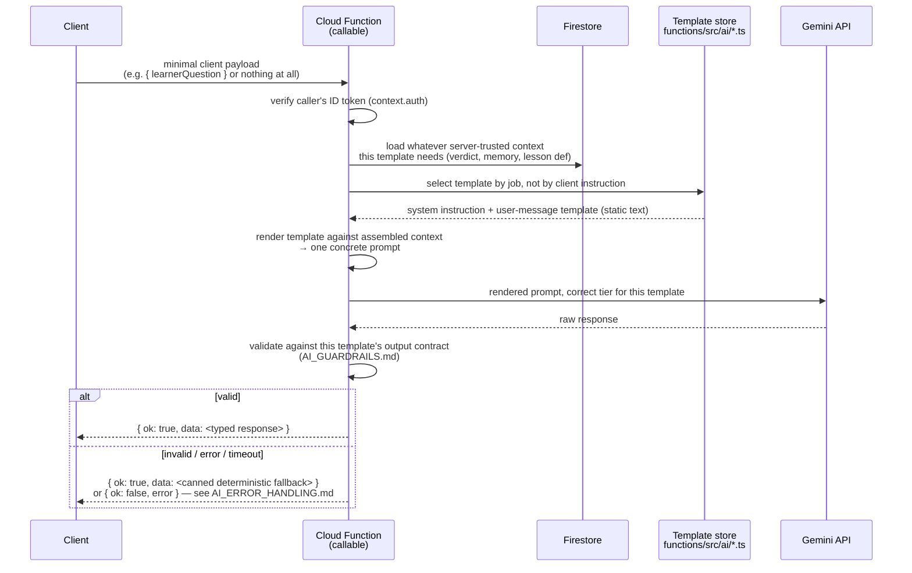

# AI Prompt Architecture

**Status:** Draft v1.0 — architecture documentation, no implementation yet
**Source of truth:** `docs/PRODUCT_SPEC.md` §14, §15, §16, §19, §20; `docs/ENGINEERING/TYPES_AND_CONTRACTS.md` §4.9, §4.10
**Companion documents:** `docs/ARCHITECTURE/AI_ARCHITECTURE.md` (system-level entry point for the AI call pattern), `docs/ARCHITECTURE/DATA_FLOW.md` (field-by-field request traces), `docs/AI/GEMINI_SPEC.md` (per-feature contracts), `docs/AI/AI_PROMPTS.md` (the template text this document describes the delivery mechanism for), `docs/AI/AI_GUARDRAILS.md`, `docs/AI/AI_COST_CONTROL.md`

## 1. Purpose

Establish and justify the one architectural principle every prompt in this product follows — **one prompt template per job, each with a defined input contract and output contract, never one do-everything system prompt** (`docs/PRODUCT_SPEC.md` §15) — and describe precisely how a template goes from static text in the repository to a rendered Gemini call and back to the client, including the specific, non-negotiable rule that prompt text never leaves the server.

## 2. Scope

In scope: why templates are split per job, the client→Function→Gemini→client call architecture, where template text physically lives and why, the assembly pipeline (template + context → rendered prompt), and the boundary between what the client can see and what it can't.

Out of scope: the literal template text (`AI_PROMPTS.md`), per-feature trigger/input/output detail (`GEMINI_SPEC.md`), validation/injection-defense mechanics (`AI_GUARDRAILS.md`), caching and rate-limiting mechanics (`AI_COST_CONTROL.md`), the system-wide component diagram (`docs/ARCHITECTURE/SYSTEM_ARCHITECTURE.md`).

## 3. The architectural principle: one prompt per job

`docs/PRODUCT_SPEC.md` §15 states this as a table, not a sentence — five rows, each with its own input contract, output contract, and cost tier:

| Template | Input | Output contract | Tier |
|---|---|---|---|
| Exercise Feedback | `{exerciseType, expected, played, accuracyScore, missedNotes, attemptNumber, learnerLevel}` | 2–3 sentences, structured, never states an uninput theory fact | Cheapest |
| Tutor Q&A | `{learnerQuestion, recentExerciseContext, learnerMemorySummary, skillLevel}` | Plain-language answer, ≤150 words unless asked for more | Mid |
| Theory Explanation | `{concept, skillLevel}` | Explanation calibrated to level | Cheapest, cacheable |
| Motivation / Nudge | `{streak, recentMilestone}` | One short line | Cheapest |
| Daily Practice Plan *(Phase 2)* | `{weakAreas, recentAccuracyTrend, availableMinutes, streak}` | Structured JSON, schema-mode | Cheapest |

**Why not one system prompt with branching instructions?** A single do-everything prompt would need to describe five different jobs, five different output shapes, and five different sets of "what data may I use" rules inside one instruction block — and every learner-facing call would pay the token cost of all five descriptions even though it only needs one. Worse, it would make the guardrail in `AI_GUARDRAILS.md` ("never invent a fact not in your input") harder to enforce and harder to test, because "your input" would mean a different thing depending on which branch of a giant conditional prompt the model decided to take. Splitting per job means:

- Each template's input contract is *exactly* the data that job needs — nothing more. A learner's question about "why are there black keys" never causes the Function to load `recentExerciseContext` it won't use (Theory Explanation's input is `{concept, skillLevel}` only).
- Each template's output contract can be validated independently and precisely (`AI_GUARDRAILS.md` §3) — a 2–3-sentence cap means something different, and is checked differently, for Exercise Feedback than a ≤150-word cap does for Tutor Q&A.
- Each template can sit on its own cost tier (§11 of `GEMINI_SPEC.md`) and its own caching policy (Theory Explanation only) without contorting a shared prompt to behave differently per caller.
- A prompt-injection attempt against one template (`AI_GUARDRAILS.md` §4) can't pivot into a different job's capabilities, because there are no other capabilities described in that template's instructions to pivot into.

## 4. Call architecture

```
client → Cloud Function (callable) → Function assembles prompt
       (template text + server-loaded, server-trusted context)
       → Function calls Gemini server-side
       → Function validates the response
       → Function returns a typed result to the client
```

### 4.1 Sequence, generic to any of the five templates



Two properties hold for every one of the five templates, without exception:

1. **The client never selects which template runs by naming it.** It calls a *feature-shaped* callable (`getExerciseFeedback`, `getTutorResponse`) with a minimal, feature-shaped payload; the Function decides internally which template applies (`GEMINI_SPEC.md` §4's mapping table). A learner cannot ask the app to run the "Exercise Feedback" template against arbitrary text, because there is no client-facing parameter that selects a template — there is only "I finished an exercise" or "here's my question."
2. **Every field of "server-loaded, server-trusted context" is read from Firestore (or the just-computed verdict) inside the Function, never accepted from the client.** This is what makes `TutorRequest.recentExerciseContext` and `.learnerMemorySummary` unforgeable (`docs/ENGINEERING/TYPES_AND_CONTRACTS.md` §4.9) — a modified client cannot fabricate a flattering performance history to manipulate the tutor's tone, because it never gets the chance to supply one.

### 4.2 Where prompt template text lives — and why that's a security boundary, not just an organizational choice

**Prompt template text — the system instructions and user-message templates in full, as authored in `AI_PROMPTS.md` — lives exclusively server-side, in `functions/src/ai/` (`docs/PRODUCT_SPEC.md` §27's folder structure). It is never sent to the client, never present in the client JS bundle, never referenced by a `NEXT_PUBLIC_*` variable, and never returned as part of any Function response.** The client receives only the *rendered output* of a call — `feedbackText`, `TutorResponse.text`, etc. — never the instruction that produced it.

This matters for a reason beyond tidy code organization: **it closes off prompt extraction as an attack surface.** A learner who opens their browser's network inspector while using the Tutor screen sees exactly one thing cross the wire on the way out: `{ learnerQuestion: "..." }` (or, for Exercise Feedback, an `ExerciseAttempt`). They see the response coming back. They never see the system instruction that told Gemini how to behave, what data it was allowed to reference, or what it was forbidden from doing — because that text was never transmitted to their browser in the first place. Contrast this with any architecture where prompt assembly happens client-side (e.g., a raw client SDK call to Gemini with a locally-constructed prompt string): in that shape, the full instruction text is necessarily visible in either the request payload or the bundled source, and a motivated learner can read it, modify their own request to override it, or simply copy the "house style" of the tutor's behavior wholesale. Keeping assembly server-side, with the templates as literal file contents in `functions/src/ai/` that only the Function process ever reads, makes prompt text as inspectable to a client as the Gemini API credential itself — which is to say, not at all (`docs/PRODUCT_SPEC.md` §19).

This is also why `docs/PRODUCT_SPEC.md` §14's rejection of a pure client-SDK pattern (Firebase AI Logic) as the *primary* mechanism for the tutor is correct, not merely cautious: "our tutor needs *server-assembled* learner context injected into every prompt, which the client can't be trusted to do honestly." A client-assembled prompt has the exact same problem as a client-computed score (`docs/ARCHITECTURE/DATA_FLOW.md` §3) — it's a place where a modified client could lie, so it can't be where the prompt is built.

### 4.3 What crosses the client/server boundary, template by template

| Template | Client sends | Client never sends | Client receives |
|---|---|---|---|
| Exercise Feedback | `ExerciseAttempt` (raw `NoteEvent[]` + metadata) — not a prompt-shaped payload at all | Any prompt field, any verdict, any score | `{ verdict: ExerciseVerdict, feedbackText: string }` |
| Tutor Q&A / Theory Explanation | `{ learnerQuestion: string }` | `recentExerciseContext`, `learnerMemorySummary`, `skillLevel`, `concept` — all server-derived | `TutorResponse { text, suggestedAction?, tier, cached }` |
| Motivation / Nudge | Nothing, in the common (pooled) case — resolved client-side from already-synced fields; nothing extra in the rare live-call case (piggybacked on an existing `getExerciseFeedback` call) | Streak/milestone values are read server-side from `UserProfile`, not re-supplied by the client | An optional nudge string alongside an existing response |
| Daily Practice Plan *(Phase 2)* | Not built for MVP | — | — |

No row in this table has a client sending prompt text, template selection, or system-instruction content in either direction. That absence is the whole point of this section.

## 5. Data structures

This document does not own type definitions (`docs/ENGINEERING/TYPES_AND_CONTRACTS.md` is canonical). The structure that matters here and isn't a shared type — because it's server-internal and deliberately never crosses any boundary — is the template module shape every file in `functions/src/ai/` follows:

```typescript
// functions/src/ai/templates/<templateName>.ts — illustrative shape, not a shared type
interface PromptTemplate<TInput, TOutput> {
  systemInstruction: string;          // static text, authored in AI_PROMPTS.md, never varies per call
  renderUserMessage: (input: TInput) => string; // interpolates context into the delimited user-message shape
  tier: 'cheapest' | 'mid';
  validateOutput: (raw: string) => TOutput | null; // null triggers the AI_GUARDRAILS.md fallback path
  fallback: (input: TInput) => TOutput;            // deterministic, no Gemini involved
}
```

This shape is what makes "one prompt per job" concrete in code, not just in prose: every template is one module exporting exactly these five things, and a Cloud Function's job is to pick the right module, call `renderUserMessage`, call Gemini with `systemInstruction` + the rendered message at the stated `tier`, then call `validateOutput` — falling back to `fallback` on `null` or on any Gemini-side error. Full validation/fallback rules: `AI_GUARDRAILS.md`.

## 6. Interfaces / contracts

- **Client-facing:** the callable functions listed in `GEMINI_SPEC.md` §4 and `docs/ARCHITECTURE/SYSTEM_ARCHITECTURE.md` §6 — `getExerciseFeedback`, `getTutorResponse` (MVP); `generateDailyPlan` (Phase 2). Every one returns the `{ ok: true, data } | { ok: false, error: { code, message } }` shape from `docs/PRODUCT_SPEC.md` §20.
- **Server-internal:** the `PromptTemplate<TInput, TOutput>` shape above, one instance per job, living in `functions/src/ai/templates/`. Cloud Functions import and call these; nothing outside `functions/src/ai/` imports Gemini's SDK directly, which keeps "does this code path ever call Gemini" a single, greppable question.

## 7. Dependencies

- Gemini API SDK — imported only inside `functions/src/ai/`, never in `apps/web`.
- Firebase Admin SDK — for the ID-token verification and Firestore reads/writes every template's context assembly depends on.
- Secret Manager — the Gemini credential itself, read only inside the Function's server-side execution, never in a `NEXT_PUBLIC_*` variable (`docs/PRODUCT_SPEC.md` §19).
- `docs/ENGINEERING/TYPES_AND_CONTRACTS.md` shared types — `ExerciseVerdict`, `AIMemorySummary`, `TutorRequest`, `TutorResponse` — imported by both `apps/web` (to type the client wrappers) and `functions/` (to type the assembly and response), but never the prompt text itself, which has no client-side representation at all.

## 8. Security considerations

- **No client→Gemini edge exists anywhere in this architecture** (`docs/PRODUCT_SPEC.md` §33; `docs/ARCHITECTURE/SYSTEM_ARCHITECTURE.md` §4.3, Property 2) — every call is `Fn → Gemini`, never `Client → Gemini`.
- **Prompt text is not a secret in the cryptographic sense, but it is treated as server-confidential** — the goal isn't that reading it would be catastrophic, it's that a learner poking at network requests or the client bundle should find *nothing* about how the tutor is instructed, because there's nothing to find (§4.2 above). This also means a template can be tuned, re-worded, or hardened against a newly discovered injection pattern without a client deploy.
- **App Check gates every Gemini-calling Function** (`docs/PRODUCT_SPEC.md` §16, §19) — this attests that the caller is the real app, which is a necessary but not sufficient defense; see `AI_GUARDRAILS.md` §4 for what closes the remaining gap (a legitimate app instance being scripted).
- **The Gemini call itself is scoped to plain text/structured-output generation only** — no tool-calling, no function-calling, no access to Firestore or any other system from inside the model's own action space. Full rationale: `AI_GUARDRAILS.md` §4.

## 9. Performance considerations

- Prompt assembly (context read + template render) happens inside the same Function invocation that's already doing other server-side work (scoring, in `getExerciseFeedback`'s case) — no separate round trip.
- Template text itself is static (loaded once per Function cold start, not re-read per call), so rendering cost is just string interpolation — negligible next to the Gemini network call itself.
- Per `docs/PRODUCT_SPEC.md` §22, 1–3 seconds of Gemini latency is acceptable for every one of these calls because all of them are already gated behind explicit user action or exercise completion — this is explicitly not a place to over-invest in speed engineering.

## 10. Testing requirements

- **Contract tests per template** (`docs/PRODUCT_SPEC.md` §26): does the rendered output match the schema, respect the length cap, and does the fallback trigger correctly on an error or malformed response — not "is Gemini's answer good," which is expensive and unfalsifiable to assert on automatically.
- **A grep-based CI check** that no file under `apps/web` imports a Gemini SDK, references a prompt template string, or contains a `NEXT_PUBLIC_GEMINI_*`-shaped variable — the automated enforcement of §4.2's boundary, mirroring the existing "no Gemini credential in the built client bundle" check (`docs/PRODUCT_SPEC.md` §29).
- **A small human-reviewed eval set** for Exercise Feedback and Tutor Q&A specifically (`docs/PRODUCT_SPEC.md` §26) — tone and fact-accuracy review, run periodically, not on every commit.

## 11. Out of scope

- The literal system-instruction and user-message-template text for each of the five jobs → `AI_PROMPTS.md`.
- Per-feature trigger/input/output/rate-limit detail → `GEMINI_SPEC.md`.
- Output validation rules, length-cap enforcement mechanics, structured-output JSON-schema definitions, prompt-injection defenses in depth → `AI_GUARDRAILS.md`.
- `AIMemorySummary` computation and lifecycle → `AI_CONTEXT_MODEL.md`.
- Theory Explanation cache key/storage, rate-limit counter implementation, cost instrumentation → `AI_COST_CONTROL.md`.
- Failure-mode-to-fallback mapping and error codes → `AI_ERROR_HANDLING.md`.
- System-wide component diagram and non-AI network boundaries → `docs/ARCHITECTURE/SYSTEM_ARCHITECTURE.md`.
