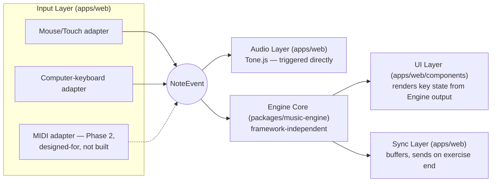

# Music Engine Architecture

**Status:** Draft v1.0 — architecture documentation, no implementation yet
**Source of truth:** `docs/PRODUCT_SPEC.md` §11, §13 (algorithms owned elsewhere, see §2), §21, §27
**Companion documents:** this document is the **architecture-level** companion to `docs/MUSIC/MUSIC_ENGINE_SPEC.md` (the detailed algorithm specification, written in a parallel batch). This document owns module boundaries and dependency rules; it does **not** own the note/chord/scale detection algorithms or the scoring formula themselves. Also see `docs/ARCHITECTURE/SYSTEM_ARCHITECTURE.md`, `docs/ARCHITECTURE/APPLICATION_ARCHITECTURE.md`, `docs/ARCHITECTURE/AUDIO_ARCHITECTURE.md`, `docs/ENGINEERING/TYPES_AND_CONTRACTS.md`.

## 1. Purpose

Define the module boundaries and dependency rules that make the brief's "tested independently" claim (`docs/PRODUCT_SPEC.md` §11, §28) structurally true rather than aspirational — specifically, the rule that `packages/music-engine` cannot import React, Next.js, Firebase, Gemini, or browser UI code, and where the four other layers (Input, Audio, UI, Sync) sit relative to it.

## 2. Scope

In scope: the five module boundaries from `docs/PRODUCT_SPEC.md` §11, the dependency rules between them, the Input Adapter contract (including the Phase-2 MIDI adapter's design), and why the Engine Core is a separate workspace package.

Explicitly out of scope — owned by `docs/MUSIC/MUSIC_ENGINE_SPEC.md` and siblings:
- The pitch-class-set matching algorithm for chord/scale detection (`docs/MUSIC/CHORD_SYSTEM.md`, `docs/MUSIC/SCALE_SYSTEM.md`)
- The scoring rubric's formula and timing-bucket thresholds (`docs/MUSIC/SCORING_SYSTEM.md`)
- MIDI-number-to-note-name derivation rules (`docs/MUSIC/NOTE_SYSTEM.md`)
- The default keyboard mapping table (`docs/MUSIC/KEYBOARD_MAPPING.md`)

This document answers "what is the Engine Core allowed to depend on, and what depends on it" — not "how does it decide a C major chord was played."

## 3. Requirements

- **The Engine Core must be independently unit-testable with plain data fixtures** — no DOM, no network, no mocking (`docs/PRODUCT_SPEC.md` §13, §26). This is the requirement every other rule in this document exists to satisfy.
- **The Engine Core must be safely importable from two different runtimes**: the browser (`apps/web`, client-side provisional evaluation) and Node.js (`functions/`, server-side authoritative evaluation) — see `DATA_FLOW.md` §3. It must therefore avoid not just framework imports but any browser-only global (`window`, `document`, `AudioContext`, etc.).
- **Audio must never wait on scoring.** Sound latency is an Audio Layer concern, decoupled from whatever the Engine Core is doing (`docs/PRODUCT_SPEC.md` §11, §12, §22).
- **New input methods must not require Engine Core changes.** Per `docs/PRODUCT_SPEC.md` §11: "the Engine Core never knows or cares which adapter produced" a `NoteEvent`.

## 4. Architecture

### 4.1 The five layers and their dependency directions



Two things this diagram makes explicit that are easy to get wrong by intuition:

1. **`NoteEvent` fans out to Audio and Engine Core in parallel, not in series.** Audio does not wait for the Engine Core's verdict, and the Engine Core does not wait for Audio to finish playing. This is what "audio latency never waits on scoring logic" (`docs/PRODUCT_SPEC.md` §11) means structurally — there is no arrow from `Audio` to `Engine` or vice versa.
2. **The UI Layer never reads `NoteEvent` directly for correctness state.** It reads Engine Core *output* (idle/hover/active come from the raw press/release itself, which the UI may read directly for immediate press feedback — but correct/incorrect key coloring specifically comes from the Engine Core's verdict, never computed in the UI Layer itself). The UI Layer "owns nothing about music theory itself" (`docs/PRODUCT_SPEC.md` §11) — if a UI component is ever found comparing MIDI numbers or checking interval sets, that is a boundary violation.

### 4.2 Engine Core: the framework-independence rule

`packages/music-engine` **must have zero import** of `firebase/*`, `react`, `next`, or any Gemini/AI SDK — restated verbatim from `docs/ENGINEERING/TYPES_AND_CONTRACTS.md` §5, rule 2, because it is the single most important sentence in this document. It is a pure function:

```
(NoteEvent[], Lesson | Exercise) → ExerciseVerdict
```

Practically, this means:
- No `import` of anything from `apps/web` or `functions/`.
- No browser globals (`window`, `document`, `navigator`, `AudioContext`) — it must run identically under Node.js (inside a Cloud Function) and inside a browser bundle.
- No network calls of any kind — not to Firestore, not to Gemini, not to anything. All the data it needs (the `Lesson`/`Exercise` definition, the `NoteEvent[]`) is passed in as arguments by its caller.
- Its only dependency is `packages/shared-types` (`NoteEvent`, `Lesson`, `Exercise`, `ExerciseVerdict`, `ChordDefinition`, `ScaleDefinition`, `Score`, `ScoringWeights` — `docs/ENGINEERING/TYPES_AND_CONTRACTS.md`).

**Why a separate workspace package, not a folder inside `apps/web`:** a folder-level convention ("please don't import React in here") is unenforceable and silently rots. A separate package in `packages/` (per `docs/PRODUCT_SPEC.md` §27's folder structure) makes a violation a *visible, reviewable dependency* — an accidental `import { useState } from 'react'` inside `packages/music-engine` breaks the package's own build/lint step, not just a convention. This is what makes "framework-agnostic... tested independently" (`docs/PRODUCT_SPEC.md` §28) structurally true rather than a stated intention.

**Two runtimes, one codebase — restated from `DATA_FLOW.md` §3:** the exact same `packages/music-engine` code runs client-side (in `apps/web`, for instant provisional feedback while a key is being judged) and server-side (in `functions/`, for the one evaluation that is ever authoritative). This is *why* the framework-independence rule matters beyond tidiness — a version that accidentally depended on a browser API would silently break the moment someone tried to run it inside a Cloud Function.

### 4.3 Input Layer: the adapter contract

Every input method — mouse/touch, computer-keyboard, and (Phase 2) MIDI — implements the same conceptual contract: **produce a stream of `NoteEvent`s, tagged with the correct `source`, and nothing else.** No adapter is allowed to call into the Engine Core, the Audio Layer, or Firestore directly; adapters only ever produce events, they never consume their own output or reach past the `NoteEvent` boundary.

| Adapter | Raw input | Normalizes to `NoteEvent` how |
|---|---|---|
| Mouse/touch | DOM pointer events on piano key elements | `midiNote` from the key's data attribute; `velocity` defaults to 100 (non-velocity-sensitive source, `docs/ENGINEERING/TYPES_AND_CONTRACTS.md` §4.1); `type: 'noteOn'`/`'noteOff'` from pointerdown/pointerup; `source: 'mouse'` or `'touch'` |
| Computer keyboard | `keydown`/`keyup` DOM events | Physical key resolved through the learner's `KeyboardMapping` (default table: `docs/MUSIC/KEYBOARD_MAPPING.md`) to a `midiNote`; `velocity` defaults to 100; `source: 'keyboard'` |
| MIDI *(Phase 2 — designed-for, not built)* | `MIDIMessageEvent` note-on/note-off, via `navigator.requestMIDIAccess()` | Velocity and timestamp taken directly from the MIDI message; `source: 'midi'` |

**MIDI adapter — why it belongs in this document even though it isn't built.** Per this project's MVP-scope instruction (`docs/PRODUCT_SPEC.md` §7, §11), MIDI input is Phase 2, but the *adapter interface* is part of the MVP design, not an afterthought bolted on later: because every adapter's only job is "emit `NoteEvent`," adding the `MIDIAdapter` in Phase 2 requires **zero changes** to the Engine Core, Audio Layer, UI Layer, or Sync Layer — only a new file in the Input Layer implementing the same contract as the row above. This is the concrete payoff of the "the Engine Core never knows or cares which adapter produced an event" rule (`docs/PRODUCT_SPEC.md` §11).

**Feature detection, not assumption:** per the verified browser gap in `docs/PRODUCT_SPEC.md` §11 — Safari (macOS and iOS) does not support the Web MIDI API and Apple has not committed to adding it — the `MIDIAdapter`, once built, must be gated behind `'requestMIDIAccess' in navigator` and degrade to a clear "MIDI isn't available in this browser" message, never a silent failure. Since this is mobile-first and a large share of mobile learners are on iOS Safari, MIDI is designed from the start as progressive enhancement, never a baseline assumption.

### 4.4 Audio Layer: triggered directly, not routed through the Engine Core

Restated because it is the specific design choice that protects the ~50ms latency target (`AUDIO_ARCHITECTURE.md`): the Audio Layer receives `NoteEvent`s from the Input Layer **directly**, in parallel with the Engine Core, not downstream of it. Sound plays the instant a key is pressed; whether that note was *correct* is a judgment the Engine Core makes independently and slightly separately, feeding only the UI Layer's correctness coloring, not gating whether sound happens at all. Full audio implementation: `AUDIO_ARCHITECTURE.md`.

### 4.5 Sync Layer: buffers, does not stream

The Sync Layer buffers `NoteEvent`s (or the Engine Core's per-note provisional results) locally, in memory, for the duration of one exercise, and hands the buffer off as an `ExerciseAttempt` only when the exercise ends — never per note, never streamed live to a Function. This is a direct consequence of `docs/PRODUCT_SPEC.md` §22's Firestore-writes-batched-at-completion rule, and is fully traced in `DATA_FLOW.md` §4.

## 5. Data structures

Owned entirely by `docs/ENGINEERING/TYPES_AND_CONTRACTS.md` — this document does not redefine any of them, only states which layer touches which:

| Type | Produced by | Consumed by |
|---|---|---|
| `NoteEvent` | Input Layer | Audio Layer, Engine Core |
| `ExerciseVerdict` | Engine Core (both client and server instances — see §4.2) | UI Layer (client instance, provisional), Sync Layer → Cloud Function (server instance, authoritative) |
| `ChordDefinition`, `ScaleDefinition` | Static config owned by `packages/music-engine` itself (not Firestore — this is engine logic, not content) | Engine Core, internally |
| `Lesson`, `Exercise` | Firestore (`Lesson`) / static app config (`Exercise`) | Engine Core, as its second argument |
| `Score`, `ScoringWeights` | `Lesson`/`Exercise` metadata (author-supplied, per `docs/PRODUCT_SPEC.md` §13: "Weights are exercise metadata, not hardcoded") | Engine Core, to compute `ExerciseVerdict.compositeScore` |

## 6. Interfaces / contracts

**Engine Core's public surface, at the architecture level** (exact function signatures: `docs/MUSIC/MUSIC_ENGINE_SPEC.md`):
- One entry point conceptually shaped as `evaluate(noteEvents: NoteEvent[], definition: Lesson | Exercise): ExerciseVerdict` — pure, synchronous, no side effects.
- Internally may expose smaller pure functions (note-name derivation, chord matching, scale matching) that `MUSIC_ENGINE_SPEC.md` documents individually — this document only guarantees they share the same dependency rules as the top-level entry point.

**Input Adapter contract** (§4.3): each adapter is a self-contained module whose only externally visible effect is emitting `NoteEvent`s (e.g., via a callback or an event emitter) — the exact mechanism (callback prop, EventTarget, Zustand action) is an `APPLICATION_ARCHITECTURE.md` / `docs/ENGINEERING/PROJECT_STRUCTURE.md` concern, not an Engine Core one.

## 7. Dependencies

- `packages/shared-types` only (§4.2). No other internal or external package dependency is permitted inside `packages/music-engine` beyond this and, if needed, a minimal, framework-agnostic utility with no side effects.
- Consumers: `apps/web` (client-side provisional evaluation) and `functions/` (server-side authoritative evaluation) — both are consumers, neither is a dependency of the engine.

## 8. Performance considerations

- The Engine Core's evaluation must be fast enough to run synchronously inside the client's per-key-press path without introducing perceptible UI lag — it is pure computation over small arrays (a single exercise's `NoteEvent[]`), not I/O, so this is a non-issue in practice as long as the framework-independence rule (§4.2) is upheld (no accidental network call hiding inside it).
- Because the same code runs server-side inside `getExerciseFeedback`, its Cloud Function cold-start/execution cost is dominated by the engine's own compute time, which — per the above — should be negligible relative to the Gemini call it's paired with (`AI_ARCHITECTURE.md`).

## 9. Error handling

- Invalid input (a `midiNote` outside `[0, 127]`, malformed velocity) is validated at the Input Layer / `NoteEvent` construction boundary (`docs/ENGINEERING/TYPES_AND_CONTRACTS.md` §4.1: "reject (log, don't crash) out-of-range values from any adapter, including MIDI hardware that misbehaves") — the Engine Core should be able to assume it receives well-formed `NoteEvent`s, but must not crash the process on a malformed one either (defensive validation at both boundaries, since the server-side caller is processing attacker-controlled input — see `SECURITY_ARCHITECTURE.md`).
- The Engine Core never throws for "the learner played the wrong note" — that's a normal, expected `ExerciseVerdict` outcome (`missedNotes`, low `accuracy`), not an error. Errors are reserved for genuinely malformed input.

## 10. Testing requirements

Per `docs/PRODUCT_SPEC.md` §13, §26: this is the highest-value test suite in the repository.
- **Near-100% coverage target** (§29 acceptance: ≥90% minimum) on chord/scale detection and scoring math specifically, because these are the "must never be wrong" guarantees the entire deterministic/Gemini boundary argument (`AI_ARCHITECTURE.md`) depends on.
- **Plain data fixtures, no mocking** — e.g., the brief's own worked example: expected `C-D-E-F-G`, played `C-D-E-G`, asserts `{ missedNotes: ['F'], accuracy: 0.8 }` directly (`docs/PRODUCT_SPEC.md` §13, §29).
- **All 12 major and 12 minor triads** correctly identified regardless of inversion or note order (§29) — a direct test of the framework-independence payoff: this is testable with zero DOM, zero network, zero Firebase emulator.
- A build/lint step that fails if `packages/music-engine` gains a disallowed import (§4.2) — this is what makes the dependency rule enforced, not just documented.

## 11. Acceptance criteria

From `docs/PRODUCT_SPEC.md` §29:
- [ ] All 12 major and 12 minor triads are correctly identified regardless of inversion or the order notes are played.
- [ ] The worked example (expected C-D-E-F-G, played C-D-E-G) returns exactly `{missedNotes: ['F'], accuracy: 0.8}`.
- [ ] Unit test coverage on chord/scale/scoring logic is ≥90%.
- [ ] `packages/music-engine` has zero import of `firebase/*`, `react`, `next`, or any Gemini/AI SDK (verified by a lint/build rule, not just code review).

## 12. Out of scope

- Chord/scale detection algorithm, interval tables → `docs/MUSIC/CHORD_SYSTEM.md`, `docs/MUSIC/SCALE_SYSTEM.md`, `docs/MUSIC/MUSIC_ENGINE_SPEC.md`
- Scoring formula, timing buckets, composite weighting → `docs/MUSIC/SCORING_SYSTEM.md`
- MIDI-number/note-name/frequency derivation → `docs/MUSIC/NOTE_SYSTEM.md`
- Default keyboard mapping table and remapping UX → `docs/MUSIC/KEYBOARD_MAPPING.md`
- Tone.js sampler/sample-loading implementation → `AUDIO_ARCHITECTURE.md`
- How the client and server calls into the Engine Core fit into the full exercise-completion request/response → `DATA_FLOW.md`
