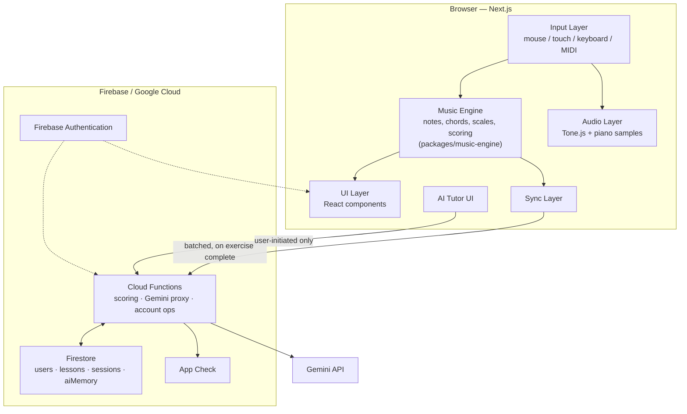

# System Architecture

**Status:** Draft v1.0 — architecture documentation, no implementation yet
**Source of truth:** `docs/PRODUCT_SPEC.md`, primarily §33 (Architecture Diagram), also §1, §2, §7, §11, §14, §16, §19, §20, §22, §23, §29, §34
**Companion documents:** `docs/ARCHITECTURE/APPLICATION_ARCHITECTURE.md`, `docs/ARCHITECTURE/DATA_FLOW.md`, `docs/ARCHITECTURE/MUSIC_ENGINE_ARCHITECTURE.md`, `docs/ARCHITECTURE/AUDIO_ARCHITECTURE.md`, `docs/ARCHITECTURE/AI_ARCHITECTURE.md`, `docs/ARCHITECTURE/FIREBASE_ARCHITECTURE.md`, `docs/ARCHITECTURE/SECURITY_ARCHITECTURE.md`, `docs/ENGINEERING/TYPES_AND_CONTRACTS.md`

This document is the entry point into the architecture set. Every other document in `docs/ARCHITECTURE/` zooms into one region of the picture drawn here; none of them should contradict it, and this document should never need to duplicate their depth.

---

## 1. Purpose

Give a single top-level view of AI Piano Tutor as a running system: what the major pieces are, how they're deployed, how they talk to each other, and — most importantly — the two structural properties that every other architecture document in this set exists to protect:

1. The piano's **Input → Engine → Audio/UI loop is a closed local loop** with zero Firebase or Gemini anywhere in its critical path.
2. **Gemini is reachable only through Cloud Functions.** There is no path from the client straight to Gemini, anywhere in this system, on purpose.

These aren't incidental facts about the implementation — they're the architectural expression of the product's design principle (`docs/PRODUCT_SPEC.md` §2): *the learner is never blocked*. If Gemini is down, the piano still works. If Firestore is down, the piano still works. If MIDI isn't available, the piano still works.

**The non-negotiable rule behind both properties, stated plainly:** Gemini must never determine whether a note or chord is correct, calculate accuracy, calculate timing, calculate scores, determine lesson completion, determine XP, determine streaks, or validate user-submitted performance data. Every one of those is deterministic application logic, owned by `packages/music-engine` and invoked server-side inside Cloud Functions — never by a Gemini call. Gemini is the AI teaching/personalization layer only: it receives an already-computed `ExerciseVerdict` and explains it in prose, after the engine has already decided. This is restated in full, with the reasoning behind it, in `AI_ARCHITECTURE.md` §3 — and restated again in `APPLICATION_ARCHITECTURE.md` and `DATA_FLOW.md` — deliberately, so it is never left implicit in any one document.

## 2. Scope

In scope: the system-level components (client, Cloud Functions, Firestore, Gemini API, App Check, Firebase Authentication), how they're deployed, the boundaries between them, and the two invariants above.

Out of scope (owned by companion documents, referenced throughout): the internal structure of the Next.js client (`APPLICATION_ARCHITECTURE.md`), the module boundaries and algorithms of the music engine (`MUSIC_ENGINE_ARCHITECTURE.md`, and `docs/MUSIC/MUSIC_ENGINE_SPEC.md`), the audio stack (`AUDIO_ARCHITECTURE.md`), the AI call pattern in depth (`AI_ARCHITECTURE.md`, and `docs/AI/`), Firebase service-by-service detail (`FIREBASE_ARCHITECTURE.md`), the security philosophy (`SECURITY_ARCHITECTURE.md`, and `docs/SECURITY/`), and precise end-to-end data traces (`DATA_FLOW.md`).

## 3. Requirements

Pulled from `docs/PRODUCT_SPEC.md` §2 and §34, restated as architectural requirements:

- **R1 — Local-first piano.** A learner must be able to play the piano — press a key, hear correct audio, see correct visual feedback, get a locally-computed correctness judgment — with the network completely unavailable. Nothing in the press-to-sound-to-visual path may await a network response.
- **R2 — Gemini is never a dependency of core functionality.** Disabling the Gemini-calling Cloud Function entirely must leave every other screen fully functional (`docs/PRODUCT_SPEC.md` §29, tested explicitly as an acceptance criterion, not assumed).
- **R3 — Gemini is unreachable from the client.** No client code path may hold, construct, or send a request directly to a Gemini endpoint. Every Gemini call is server-initiated, inside a Cloud Function, using a server-held credential.
- **R4 — The client is never trusted for scored data.** Any data that affects XP, streak, lesson completion, or progress must be independently recomputed server-side from raw input, never accepted as a client-reported verdict (detailed in `SECURITY_ARCHITECTURE.md` and `DATA_FLOW.md`).
- **R5 — Degraded, not blocked.** Firestore or Gemini being unreachable produces a visible, non-alarming degraded state (`docs/PRODUCT_SPEC.md` §10), never a dead end and never a silent failure.

## 4. Architecture

### 4.1 Components

| Component | Technology | Role |
|---|---|---|
| Client | Next.js (App Router), TypeScript, React | Renders the UI, runs the Input/Engine/Audio/UI/Sync layers described in `APPLICATION_ARCHITECTURE.md`, deployed on Firebase App Hosting |
| Firebase App Hosting | Managed hosting | Next.js-native deployment target — supports SSR/framework-aware builds without a hand-rolled Cloud Run setup (`docs/PRODUCT_SPEC.md` §16) |
| Firebase Authentication | Identity provider | Anonymous try-first, Google Sign-In, email/password (`docs/PRODUCT_SPEC.md` §18) |
| Firestore | Primary datastore | User profiles, progress, lesson content, practice sessions, AI memory (`docs/PRODUCT_SPEC.md` §17; see `FIREBASE_ARCHITECTURE.md`) |
| Cloud Functions (2nd gen) | Server-side compute | The only component allowed to call Gemini with real credentials, and the only component allowed to write scored/progress data (`docs/PRODUCT_SPEC.md` §14, §19, §20) |
| App Check | Abuse prevention | Attests that traffic hitting Firestore and the Gemini-calling Functions originates from the real app, not a script (`docs/PRODUCT_SPEC.md` §16) |
| Gemini API | AI teaching/personalization layer | Reachable only from inside Cloud Functions; never holds a credential the client can see |

### 4.2 Diagram

Reproduced verbatim from `docs/PRODUCT_SPEC.md` §33:

**Diagram note — MIDI is Phase 2, shown as designed-for.** The Input Layer box lists `mouse / touch / keyboard / MIDI` together because the *design* treats all four as equivalent producers of the same `NoteEvent` shape (`docs/ENGINEERING/TYPES_AND_CONTRACTS.md` §4.1). Per `docs/PRODUCT_SPEC.md` §7 and §11, only mouse, touch, and computer-keyboard input ship in MVP; the MIDI adapter is designed-for-but-not-built (see `MUSIC_ENGINE_ARCHITECTURE.md` §6 for the adapter contract) and is feature-detected at runtime once it exists, never assumed as a baseline.

### 4.3 Reading the diagram: two properties, on purpose

**Property 1 — the piano is a closed local loop.** Trace the top subgraph: `Input → Engine`, `Input → Audio`, `Engine → UI`. Every one of those three arrows stays entirely inside the browser. There is no arrow from `Input`, `Engine`, `Audio`, or `UI` into the `FB` subgraph or into `Gemini`. The *only* arrow leaving the local loop is `Sync → Fn`, and it is explicitly labeled `batched, on exercise complete` — not per note, not per keystroke, not continuous. This is what makes R1 (§3) true structurally rather than by convention: a developer would have to actively add a new arrow to break it, which is a visible, reviewable change, not an accidental one.

**Property 2 — Gemini has exactly one inbound edge, from Cloud Functions.** Find every arrow that touches the `Gemini` node in the diagram: there is exactly one, `Fn --> Gemini`. `TutorUI` — the one client component that initiates AI-relevant interaction — has an arrow to `Fn`, labeled `user-initiated only`, not to `Gemini` directly. This is R3 (§3) made structural: the client cannot call Gemini even if a developer wanted a shortcut, because the client never holds a Gemini credential (see `SECURITY_ARCHITECTURE.md` §Gemini credential protection) — the arrow simply doesn't exist to draw.

**Supporting detail in the diagram:**
- `Fn <--> FS` (bidirectional): Cloud Functions both read Firestore (to assemble AI context, load lesson definitions) and write it (progress, sessions, AI memory) — this is the *only* path by which those documents are written; see R4.
- `Fn --> AC`: App Check gates the Gemini-calling Functions specifically (`docs/PRODUCT_SPEC.md` §16, §19) — detailed in `SECURITY_ARCHITECTURE.md`.
- `Auth -.-> UI` and `Auth -.-> Fn` (dotted): identity is a cross-cutting concern read by both the client (to know who's signed in) and every callable Function (to verify the caller via ID token, never trusting a client-supplied `uid` — `docs/PRODUCT_SPEC.md` §18).

## 5. Data structures

This document does not own type definitions — `docs/ENGINEERING/TYPES_AND_CONTRACTS.md` is canonical for all of them. At the system level, the types that matter are the ones that *cross a component boundary*:

| Crosses | Boundary | Type(s) |
|---|---|---|
| Client → Cloud Functions | `Sync` → `Fn` (batched, exercise complete) | `ExerciseAttempt` (containing raw `NoteEvent[]`) — never a client-computed `ExerciseVerdict` |
| Client → Cloud Functions | `TutorUI` → `Fn` (user-initiated) | `{ learnerQuestion: string }` only — never a full `TutorRequest` |
| Cloud Functions → Client | `Fn` → client (response) | `ExerciseVerdict`, `TutorResponse` — always server-computed, never echoed-back client input |
| Cloud Functions ↔ Firestore | `Fn <--> FS` | `UserProfile`, `Lesson`, `PracticeSession`, `AIMemorySummary` |
| Cloud Functions → Gemini | `Fn` → `Gemini` | Prompt text assembled server-side from `TutorRequest` / exercise-feedback context — never a raw `NoteEvent[]` (`docs/ENGINEERING/TYPES_AND_CONTRACTS.md` §5, rule 3) |

Full shapes, ownership, and validation rules for each type: `docs/ENGINEERING/TYPES_AND_CONTRACTS.md`. Full step-by-step traces of the two flows above: `DATA_FLOW.md`.

## 6. Interfaces / contracts

No public REST API exists in MVP (`docs/PRODUCT_SPEC.md` §20). The client talks to Firestore directly via the SDK (realtime `onSnapshot` reads) and to Cloud Functions via **callable functions** (not raw HTTPS functions — callables handle auth-context passing and CORS automatically).

**Callable functions (MVP):**

| Function | Purpose |
|---|---|
| `getExerciseFeedback` | Accepts an `ExerciseAttempt`, re-validates it server-side against the `Lesson`/`Exercise` definition using `packages/music-engine`, writes `PracticeSession` + `ProgressSummary`, and returns the authoritative `ExerciseVerdict` (see `AI_ARCHITECTURE.md` for its Gemini-calling responsibility) |
| `getTutorResponse` | Accepts `{ learnerQuestion }`, server-assembles the rest of `TutorRequest` from Firestore, calls Gemini, returns a validated `TutorResponse` |
| `deleteAccount` | Deletes a user's full data subtree on request |
| `exportUserData` | Exports a user's full data subtree on request |

**Callable function (Phase 2, designed-for):**

| Function | Purpose |
|---|---|
| `generateDailyPlan` | Gemini-personalized daily practice plan, deferred until there's real usage data to personalize against (`docs/PRODUCT_SPEC.md` §7 pushback) |

**Error contract:** every callable function returns a typed `{ ok: true, data }` or `{ ok: false, error: { code, message } }` shape — one consistent way for the client to decide "show a fallback" vs. "show a retry button" instead of branching on a raw exception. This is what makes R5 (§3) implementable rather than aspirational.

## 7. Dependencies

- **Next.js** (App Router) — client framework, deployed via Firebase App Hosting specifically because App Hosting is Next.js-native.
- **Firebase Authentication, Firestore, Cloud Functions (2nd gen), App Check** — see `FIREBASE_ARCHITECTURE.md` for the full service table and the explicit rationale for *not* using Firebase Storage.
- **Gemini API** — reachable only server-side; see `AI_ARCHITECTURE.md`.
- **Tone.js + Salamander Grand Piano samples** — the Audio Layer's dependency, entirely local to the client; see `AUDIO_ARCHITECTURE.md`. Not a system-level dependency in the sense of anything above (no network component involved once samples are cached).
- **Zustand** — client/engine state; see `APPLICATION_ARCHITECTURE.md` §State management.

## 8. Security considerations

Full treatment in `SECURITY_ARCHITECTURE.md`. At the system level, the load-bearing fact is the one stated in §4.3 above: the diagram has no client→Gemini edge and no client→Firestore-write edge for scored data. Everything else — default-deny rules, credential storage, rate limiting, App Check, prompt-injection hygiene — exists to make those two missing edges actually unbreakable, not just undrawn.

## 9. Performance considerations

Per `docs/PRODUCT_SPEC.md` §22: the piano interaction never waits on the network. The *only* network calls in the entire system are:
1. Initial data load (auth state, lesson list, user profile) on app start.
2. Batched exercise-completion sync (`Sync → Fn`), once per completed exercise/lesson step, not per note.
3. Explicit user-initiated Gemini calls (opening the tutor, asking "why," and — per `AI_ARCHITECTURE.md` — automatically as part of #2's response for the Exercise Feedback template specifically).

Because #3 is already gated behind explicit action or exercise completion (never polled, never per-keystroke — `docs/PRODUCT_SPEC.md` §14), 1–3 seconds of Gemini latency is an acceptable UX cost there as long as a "thinking" state is shown; this is explicitly *not* a place to over-invest speed engineering (`docs/PRODUCT_SPEC.md` §22). The latency budget that *does* matter — key-press to audible sound, target ~50ms — lives entirely inside the local loop described in §4.3's Property 1, detailed in `AUDIO_ARCHITECTURE.md` and `MUSIC_ENGINE_ARCHITECTURE.md`.

## 10. Error handling

- **Firestore unreachable:** the client relies on the Firestore SDK's built-in offline persistence (`enableIndexedDbPersistence`) — reads serve from cache, writes queue and flush on reconnect (`docs/PRODUCT_SPEC.md` §23). A persistent, non-alarming banner ("Playing offline — your progress will sync later") surfaces the degraded state (`docs/PRODUCT_SPEC.md` §10); the piano and current lesson keep working locally regardless.
- **Gemini/Cloud Functions unreachable:** the AI Tutor screen shows a "temporarily unavailable, here's what to practice instead" fallback card built from deterministic data — never a dead end. The rest of the app is entirely unaffected (R2, §3).
- **Auth token invalid/expired:** every callable Function verifies the caller's ID token via the Admin SDK before doing anything user-specific (`docs/PRODUCT_SPEC.md` §18); a failed check returns the `{ ok: false, error }` shape from §6, not a raw 401 the client has to interpret.

## 11. Testing requirements

System-level testing is the canonical end-to-end flow (`docs/PRODUCT_SPEC.md` §26, §28 milestone M2): *user opens lesson → identifies note → presses piano key → receives result → progress is saved*, run as an automated Playwright test. This is the test that has to pass before "MVP complete" is called done.

Component-level testing is owned by each companion document: music-engine unit tests (`MUSIC_ENGINE_ARCHITECTURE.md`), Firebase emulator integration tests (`FIREBASE_ARCHITECTURE.md`), Firestore rules tests (`SECURITY_ARCHITECTURE.md`), AI contract tests (`AI_ARCHITECTURE.md`), Playwright piano interaction tests (`AUDIO_ARCHITECTURE.md`, `APPLICATION_ARCHITECTURE.md`).

## 12. Acceptance criteria

System-level items from `docs/PRODUCT_SPEC.md` §29:
- [ ] Disabling the Gemini Function entirely leaves every other screen fully functional — tested explicitly, not assumed.
- [ ] No Gemini credential appears anywhere in the built client bundle — grepped as a CI check.
- [ ] A learner can complete the full MVP lesson sequence with no dead end or broken step.
- [ ] Progress persists across sign-out/sign-in and across devices for the same account.

Full acceptance list, organized by subsystem: see each companion document's own Acceptance Criteria section.

## 13. Out of scope

- Client-internal module/folder structure and state management → `APPLICATION_ARCHITECTURE.md`, `docs/ENGINEERING/PROJECT_STRUCTURE.md`
- Music theory algorithms (chord/scale detection, scoring formula) → `MUSIC_ENGINE_ARCHITECTURE.md`, `docs/MUSIC/MUSIC_ENGINE_SPEC.md`
- Audio stack implementation detail → `AUDIO_ARCHITECTURE.md`
- Gemini prompt templates, cost controls, memory aggregation → `AI_ARCHITECTURE.md`, `docs/AI/`
- Firestore schema field-by-field, indexes → `FIREBASE_ARCHITECTURE.md`, `docs/DATA/FIRESTORE_SCHEMA.md`
- Literal Firestore Security Rules syntax → `SECURITY_ARCHITECTURE.md` (philosophy only), `docs/SECURITY/FIRESTORE_SECURITY_RULES.md` (syntax)
- Precise field-level, step-by-step data traces → `DATA_FLOW.md`
