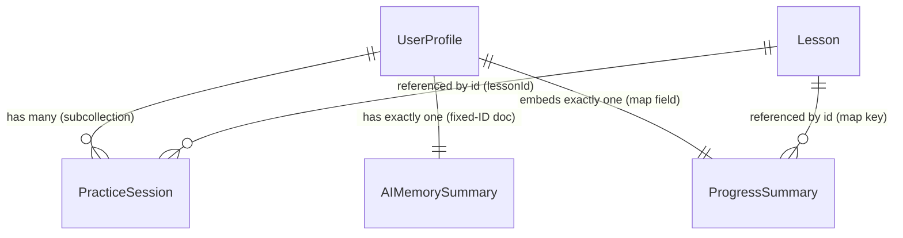

# Data Model

## 1. Purpose

The conceptual/relational companion to `FIRESTORE_SCHEMA.md`. That document specifies the precise collection/document layout — the *what*. This document explains how the four core entities (`UserProfile`, `PracticeSession`, `AIMemorySummary`, `Lesson`) relate to each other and *why* the schema takes the shape it does — embedded map vs. subcollection vs. top-level collection — and how data flows between entities over a learner's lifecycle.

Source of truth for the entities themselves: `docs/ENGINEERING/TYPES_AND_CONTRACTS.md` §4. Source of truth for the schema decisions being explained here: `docs/PRODUCT_SPEC.md` §17.

## 2. Scope

The relationships between `UserProfile`, `PracticeSession`, `AIMemorySummary`, `Lesson`, and (briefly, for accuracy) the non-Firestore static entities they reference by ID (`Exercise`, `ChordDefinition`, `ScaleDefinition`). Excludes exact field types (`TYPES_AND_CONTRACTS.md`), exact paths (`FIRESTORE_SCHEMA.md`), and authorization (`DATA_ACCESS_RULES.md`).

## 3. Entities at a Glance

| Entity | Firestore-backed? | Cardinality per user | Nature |
|---|---|---|---|
| `UserProfile` | Yes — `users/{uid}` | 1 | The root entity for a learner. Mutable, Function-written (except `settings`). |
| `ProgressSummary` | Yes — embedded field on `UserProfile`, not its own document | 1 (embedded) | A derived aggregate, one entry per lesson touched. |
| `PracticeSession` | Yes — `users/{uid}/practiceSessions/{sessionId}` | 0..N | An immutable fact: "this attempt happened, here's the verdict." The append-only source log. |
| `AIMemorySummary` | Yes — `users/{uid}/aiMemory/summary` | 1 | A derived aggregate, rewritten in place, over a rolling window of recent `PracticeSession`s. |
| `Lesson` | Yes — `lessons/{lessonId}` | N/A (global, not per-user) | Independent, public content. Referenced by ID, never embedded into or duplicated across user data. |
| `Exercise`, `ChordDefinition`, `ScaleDefinition` | **No** — static app/engine config | N/A | Referenced by ID from `PracticeSession`/`Exercise.pool`, but not part of the Firestore data model at all. Noted here only so a reader doesn't assume every ID reference resolves to a Firestore document. |

## 4. Relationships

- **`UserProfile` 1 — N `PracticeSession`.** A subcollection relationship. Every completed exercise or lesson attempt by that learner produces exactly one `PracticeSession` document; the collection only grows.
- **`UserProfile` 1 — 1 `AIMemorySummary`.** Not a log — a single rewritten-in-place aggregate view of that learner's recent performance, purpose-built as Gemini Tutor context.
- **`UserProfile` 1 — 1 `ProgressSummary`.** Not even a document relationship — `ProgressSummary` is a map *field* embedded directly on the `UserProfile` document. There is no independent existence of a "progress summary object" outside its parent user document.
- **`Lesson` 1 — N `PracticeSession`** and **`Lesson` 1 — N `ProgressSummary` entries.** `Lesson` is referenced *by ID* from both — `PracticeSession.lessonId` and `ProgressSummary`'s map keys — never embedded, and `Lesson` itself never embeds or references any user data. This independence is deliberate (§5).
- **`PracticeSession.exerciseId`** can alternatively reference a non-Firestore `Exercise` (static config) instead of a `Lesson`. `ExerciseAttempt` (`TYPES_AND_CONTRACTS.md` §4.4) states "exactly one of `lessonId` / `exerciseId` is present" — meaning `PracticeSession`'s "what was attempted" reference is polymorphic across a Firestore-backed entity (`Lesson`) and a static-config entity (`Exercise`) that isn't a Firestore document at all. Anyone writing a lookup/join against `PracticeSession` needs to branch on which field is populated before deciding where to resolve it.

## 5. Why the Shape Is This Way

**`Lesson` is deliberately independent of every user.** It carries no reference to any `uid`, and no `UserProfile` embeds any `Lesson` content — only IDs cross the boundary. This buys two things directly stated or implied by `PRODUCT_SPEC.md` §17: (a) a future Phase-3 admin CMS can edit lesson content without touching a single byte of user data, and (b) per-user reads never pay the cost of lesson content size, since `Lesson` documents are fetched separately (and are public-read, so they're cheap to cache client-side across all users rather than being fetched per-user).

**`ProgressSummary` is embedded, not a subcollection, specifically to bound read cost.** `PRODUCT_SPEC.md` §17 states this directly: at ~12–15 MVP lessons, one map on the user document costs one read for the whole dashboard instead of N per-lesson-document reads. This is a read-count optimization that trades away per-lesson-progress query flexibility (you can't, for example, cheaply query "all users who completed lesson X" without a different structure) for cheap, single-read dashboard loads — the right trade at MVP's lesson count and query pattern, explicitly flagged for revisit only if lesson count grows enough to matter.

**`PracticeSession` stays a raw, append-only log — not just a source that gets summarized and discarded.** Two independent consumers read it directly, not just derived aggregates of it: the Progress/Stats screen queries it directly (via the composite index on `(userId, completedAt desc)`, see `FIRESTORE_INDEXES.md`), and the `AIMemorySummary` recompute logic aggregates over "recent" sessions each time it runs (`TYPES_AND_CONTRACTS.md` §4.8) — a moving window recomputed from source facts, not a running total maintained incrementally forever. Keeping the raw log is what makes both of those possible; a schema that only kept aggregates would lose the ability to redefine "recent" or re-run a corrected aggregation later.

**Two different derived views exist over the same `PracticeSession` log, because they serve two different consumers with two different freshness/scope needs:**

| Derived view | Recomputed when | Scope | Consumer |
|---|---|---|---|
| `ProgressSummary` (one `LessonProgress` entry) | Synchronously, as a side effect of `getExerciseFeedback` | Narrow — the one lesson/exercise just attempted | Dashboard, lesson-unlock logic |
| `AIMemorySummary` | By the AI aggregation logic in `functions/src/ai/`, over recent sessions | Broad — skill level, weak notes/chords, strengths across many sessions | Gemini Tutor Q&A context (`TutorRequest`) |

Both are, in principle, rebuildable from the `PracticeSession` log — the log is the durable fact; the aggregates are convenience views. This mirrors the double-enforcement principle `TYPES_AND_CONTRACTS.md` §5.1 states for server-written-only data generally: the log is the trust boundary's actual evidence, the aggregates are what the UI/AI consume so they don't have to recompute from scratch on every read.

**Why none of this lives in a normalized relational shape (e.g., a join table for lesson↔user progress):** Firestore is a document database; `PRODUCT_SPEC.md` §16 names this as a deliberate, acknowledged departure from the founder's default Postgres-based stack, justified specifically by Google AI Studio's Firebase-native provisioning flow for *this* project — not a general recommendation. The embedding/ID-reference choices above are the idiomatic Firestore way to get relational-*like* behavior (bounded read cost per screen) without an actual join capability, which Firestore doesn't have natively.

## 6. Lifecycle Summary

1. A learner attempts a lesson or exercise. The client sends raw `NoteEvent[]` (never a verdict) to `getExerciseFeedback`.
2. The Cloud Function re-validates server-side against the `Lesson`/`Exercise` definition (loaded independently, not trusted from the client) and computes an `ExerciseVerdict`.
3. The Function writes one new `PracticeSession` document (the permanent fact) and, synchronously, updates the relevant entry in `ProgressSummary` (the narrow, dashboard-facing view).
4. Separately — on tutor invocation, not on every session — the AI aggregation logic reads recent `PracticeSession`s for that user and rewrites `AIMemorySummary` in place.
5. `Lesson` never changes as a result of any of this. It is read-only content that `PracticeSession` and `ProgressSummary` point *at*, never modified by learner activity.

## 7. Out of Scope

- Exact field types and nullability (`TYPES_AND_CONTRACTS.md`).
- Exact Firestore paths (`FIRESTORE_SCHEMA.md`).
- Who can read/write each entity (`DATA_ACCESS_RULES.md`).
- Index definitions supporting the query patterns described here (`FIRESTORE_INDEXES.md`).
- Retention and deletion-cascade behavior over this entity graph (`DATA_RETENTION.md`).
