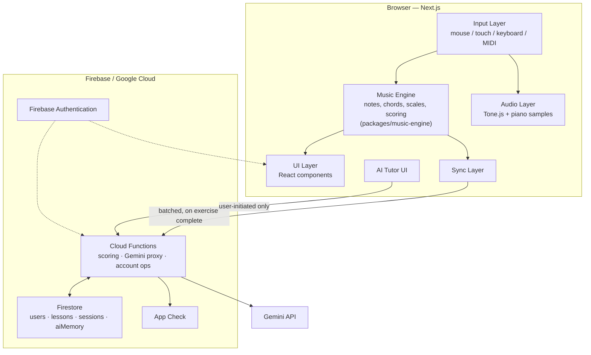

# AI Piano Tutor — Product & Technical Specification

**Prepared for:** Linford Musiyambodza / Linfy Tech Solutions
**Date:** August 27, 2026
**Status:** Draft v1.0 — specification only, no implementation yet
**Author's role:** Product Architect, UX Designer, Music Education Specialist, AI Engineer, Full-Stack Architect (as requested)

> This document defines the product before any code is written, per Spec-Driven Development. It is meant to be handed to a coding agent (Google AI Studio Build, Google Antigravity, or Claude Code) as the implementation brief. Sections marked **⚠ Pushback** contain places where I've changed, cut, or challenged something in the original brief — read those first if you only have five minutes.

---

## Table of Contents

1. Executive Summary
2. Product Vision
3. Problem Statement
4. Target Users
5. User Stories
6. Core Features
7. MVP Scope
8. Future Roadmap
9. User Experience Architecture
10. Screen-by-Screen Specification
11. Piano/Music Engine Architecture
12. Audio Architecture
13. Music Theory Engine
14. AI/Gemini Architecture
15. AI Prompt Architecture
16. Firebase Architecture
17. Firestore Data Model
18. Authentication
19. Security Architecture
20. API Architecture
21. State Management
22. Performance
23. Offline Strategy
24. Accessibility
25. Analytics
26. Testing Strategy
27. Project Folder Structure
28. Development Milestones
29. Acceptance Criteria
30. Risks and Technical Challenges
31. Cost Considerations
32. Recommended Technology Stack
33. Architecture Diagram
34. Final MVP Definition
35. Build Instructions for Google AI Studio / Antigravity

---

## 1. Executive Summary

**What this is:** a mobile-first web app that teaches complete piano beginners through an interactive virtual keyboard, structured lessons, two practice-game modes, and a Gemini-powered tutor — built on Next.js, Firebase, and the Gemini API.

**The decision that matters most:** your instinct to keep Gemini out of the core loop is correct, and this spec makes it structural, not a footnote. Every note, chord, scale, and timing judgment is computed by deterministic TypeScript. Gemini never decides whether a note was right — it only explains, encourages, and personalizes, after the engine has already scored the attempt. That's what makes the app fast (no network round-trip to know if a key press was correct), cheap (Gemini is called for teaching moments, not per keystroke), and testable (music logic gets unit tests; prompts get evaluated separately). Section 14 makes this boundary explicit and non-negotiable.

**Where this spec pushes back on the brief:**

| Area | Brief assumed | Recommendation | Why |
|---|---|---|---|
| Build environment | "Build it in Google AI Studio" | Use AI Studio Build (or Antigravity) to scaffold and provision Firebase, but do the audio-timing engine, security rules, and tests in a real repo with a full coding agent | Firebase Studio — the tool this kind of workflow was designed around — is being sunset (new workspaces disabled June 2026, shutdown March 2027); Google is now steering people to AI Studio Build or Antigravity instead. Neither is built for hand-tuning Web Audio scheduling or reviewing Firestore security rules line by line. |
| Gemini security | Implied a bespoke server proxy is the only safe pattern | Cloud Functions as the primary proxy; Firebase AI Logic (Google's client-SDK + App Check pattern) as a lighter fallback for simple chat | Firebase AI Logic already solves key exposure well — no need to reinvent it. But our tutor needs *server-assembled* learner context injected into every prompt, which the client can't be trusted to do honestly, so a thin Functions layer stays primary. |
| Audio sample storage | Firebase Storage for audio assets | Bundle piano samples as static assets served by the same CDN as the app | These are public, immutable files. Storage adds an auth-rule and latency layer for zero benefit on something that should just be cached at the edge. |
| Scope | The 44-section brief reads like a 6–12 month roadmap | Real MVP is ~6–8 weeks: auth, piano, keyboard input, deterministic note/chord ID, ~12 lessons, one game mode, a thin AI tutor, a dashboard | Section 7 cuts MIDI, songs, admin tooling, and most gamification to Phase 2+. Building all 44 sections before shipping means never shipping. |
| AI memory | "Design how the AI remembers the learner" | One structured Firestore document per learner, rewritten each session — never raw transcript logs | This matches your own instinct in the brief (section 31); this spec just makes the cost and privacy trade-off explicit. |
| Piano samples | Not specified | Salamander Grand Piano (CC BY 3.0) | Free and high quality, but legally requires a visible attribution credit — flagged now so it doesn't get missed at launch. |

**Bottom line:** the product idea is sound and "engine below, AI on top" is the right architecture. The main execution risk isn't the AI layer — it's treating a real-time audio app like a typical CRUD app. Sections 11–13, 22, and 30 exist specifically to prevent that mistake.

## 2. Product Vision

AI Piano Tutor is a browser-based piano teacher for people who have never touched a piano and may not own one. A learner opens the app on their phone, sees a real (if compact) piano keyboard, and within two minutes has played their first note, been told what it's called, and been invited to try the next one. Structured lessons carry them from "which key is C" to playing a simple melody with correct notes and roughly correct timing, with a Gemini-powered tutor available at any point to answer questions like "why does this sound wrong" in plain language.

**North star:** a first-time visitor plays a recognizably correct 5-note melody within their first session, unassisted by a human. Every section of this spec is in service of that one moment — it's the proof that interactive practice beats a YouTube tutorial or a method book for absolute beginners.

**Design principle carried through every section:** the learner is never blocked. If Gemini is down, the piano still works. If Firestore is down, the piano still works. If MIDI isn't available, the piano still works. This isn't a nice-to-have bullet point — it's the reason the music engine and the AI layer are architecturally separate (section 14).

## 3. Problem Statement

**Facts:**

- Learning piano traditionally requires a physical instrument, a human teacher, or the discipline to work through static method books — all three raise the barrier to starting.
- Interactive piano-learning products already exist (Simply Piano, Skoove, Flowkey, Yousician) and have proven the category has real demand.
- Browser audio (Web Audio API) and on-device MIDI (Web MIDI API, outside Safari) are mature enough to support this today — this is a product bet, not a technology bet.

**Assumptions this spec is built on, not yet validated with real users:**

- That a Gemini-powered conversational tutor is a meaningful differentiator over incumbents that mostly use pre-scripted feedback rather than an LLM.
- That beginners specifically want natural-language Q&A ("why does my chord sound wrong") rather than just more exercises — plausible, unverified.
- That mobile-first is the right primary form factor for practicing an instrument that benefits from a wider screen — worth a short usability check before over-investing in the mobile layout (section 9).

⚠ **Recommendation:** before or in parallel with MVP build, run 5–10 informal sessions watching actual beginners (section 4 persona) attempt the first-note flow. That's roughly a two-day investment and it de-risks the single biggest assumption in this spec — that interactivity itself is the value driver, not just the content. This is in the spirit of evidence-over-pitch customer discovery, not a formality to skip.

## 4. Target Users

**Primary persona — the complete beginner:** no piano access, no music-theory background, motivated by curiosity or one specific goal ("I want to play one song for someone"). Owns a smartphone and/or laptop. Practices in short, irregular sessions (5–20 minutes). This is the persona every MVP decision optimizes for.

**Secondary persona — the rusty returner:** had lessons as a child or plays another instrument, wants a refresher without being talked down to. Needs the onboarding skill-check (section 10) to route them past material they already know — this is the main reason a skip-ahead assessment exists at all.

**Explicitly not the v1 target (revisit in Phase 3+):** intermediate/advanced pianists wanting sight-reading or classical repertoire, two-hand advanced technique, users with no internet access at all (offline is *resilience*, not the primary mode — see section 23 and the scope note in section 7).

## 5. User Stories

Grouped by epic. `[MVP]` ships in the first release; `[Future]` is scoped but deferred (section 8).

**Onboarding & Auth**
- As a new visitor, I want to try the piano before creating an account, so I can decide if this is for me before committing. `[MVP]`
- As a returning learner, I want to sign in with Google in one tap, so I don't re-enter credentials on a new device. `[MVP]`

**Learning the Keyboard**
- As a beginner, I want the app to show me where Middle C is and confirm when I find it, so I have an anchor point on the keyboard. `[MVP]`
- As a beginner, I want a wrong key press treated as a normal part of learning, not a failure state, so I don't get discouraged. `[MVP]`

**Note Identification Game**
- As a learner, I want a quick game that asks me to find notes by name with a running accuracy score, so I build recall speed. `[MVP]`
- As a learner, I want the game's difficulty to increase as I improve, so it stays challenging. `[MVP]`

**Scales & Chords**
- As a learner, I want to see and hear a scale demonstrated before attempting it, so I know what correct sounds like. `[MVP]`
- As a learner, I want to know specifically which note I missed in a scale attempt, not just "wrong," so I know what to fix. `[MVP]`
- As a learner, I want to build from single notes to simple triads gradually, so chords don't feel like a wall. `[MVP]`

**AI Tutor**
- As a learner, I want to ask "why does my chord sound wrong" in plain language and get an answer grounded in what I actually just played, so the help feels relevant, not generic. `[MVP]`
- As a learner, I want the tutor to suggest what to practice today based on my recent mistakes, so I don't have to plan my own practice. `[MVP]`
- As a returning learner, I want the tutor to already know I'm weak on F and B without re-explaining, so sessions don't restart from zero. `[MVP]`

**Practice & Progress**
- As a learner, I want one daily practice session generated for me, so I don't have to decide what to do each time I open the app. `[MVP]`
- As a learner, I want a streak and basic stats visible, so I have a reason to come back tomorrow. `[MVP]`
- As a returning learner, I want to resume exactly where I left off, so nothing is lost between sessions. `[MVP]`

**Piano Interaction**
- As a learner on a laptop, I want to play using my computer keyboard, so I don't need hardware to practice. `[MVP]`
- As a learner on my phone, I want the piano to stay usable on a small screen without keys becoming unplayably tiny. `[MVP]`
- As a learner with a MIDI keyboard, I want to connect it and have the app recognize what I actually play. `[Future — MIDI]`

**Songs**
- As a learner who has the basics, I want to learn a real (public-domain) song section by section, so I have something to show for my practice. `[Future]`

**Accessibility**
- As a screen-reader user, I want lesson instructions and feedback announced, so I'm not locked out of the non-piano parts of the app. `[MVP — see section 24 for what's realistic on the piano itself]`

**Content Ops**
- As Linford (admin), I want to edit lesson content without a code deploy, so content iteration doesn't block on engineering time. `[Future]`

## 6. Core Features

**Virtual Piano**
- Playable keyboard: white/black keys, note labels (toggleable), press/hover animation `[MVP]`
- Mouse, touch, and computer-keyboard input `[MVP]`
- Adjustable visible octave range, sustain toggle, volume control `[MVP]`
- MIDI keyboard input (Chrome/Edge/Android only — no Safari) `[Future]`

**Learning Modes**
- Explore / Free Play with live note & chord recognition `[MVP]`
- Guided "Learn the Keys" flow with glow-and-confirm interaction `[MVP]`
- Note Identification game with adaptive difficulty `[MVP]`
- Guided scale lessons (major scale first; more scales later) `[MVP: C major + 3–4 common keys → Future: full set]`
- Chord lessons (major triads first) `[MVP: major triads → Future: minor/7th/diminished/augmented/inversions]`
- Song learning module `[Future — public-domain and original content only, see section 30 licensing risk]`

**AI Tutor**
- Conversational Q&A grounded in the learner's actual recent performance `[MVP]`
- Structured feedback after an exercise ("you missed F between E and G") `[MVP]`
- Personalized daily practice plan `[MVP: rule-based → Future: Gemini-personalized once there's usage data, see section 7 pushback]`
- Practice-plan chat, motivation nudges `[MVP, lightweight]`

**Progress & Gamification**
- XP, streak, lesson completion tracking `[MVP]`
- Weak-note/weak-chord tracking surfaced on the dashboard `[MVP]`
- Achievements/badges beyond streak `[Future]`
- Leaderboards / multiplayer `[Future, low priority]`

**Account & Data**
- Firebase Auth: anonymous try-first, Google Sign-In, email/password, anonymous-to-linked upgrade `[MVP]`
- Firestore-backed progress sync across devices `[MVP]`
- Data export / account deletion (privacy) `[MVP — required for any real launch, not optional polish]`

## 7. MVP Scope

**In MVP:**

- Firebase Auth: anonymous try-first session, Google Sign-In, email/password, account linking
- Virtual piano: mouse/touch/keyboard input, ~2–3 octave visible range with pan, sustain, volume
- Deterministic music engine: MIDI-number-based note ID, major/minor triad detection, major-scale validation, timing/accuracy scoring (section 13)
- ~12–15 structured lessons covering keyboard orientation → note names → octaves → simple melodies → basic rhythm → intro to major triads (brief's Levels 1–6, roughly)
- Note Identification game, one mode, adaptive difficulty
- Guided scale lessons: C major plus 3–4 more common keys
- Chord lessons: major triads, root position only
- Gemini tutor: free-form Q&A + structured exercise feedback (two prompt templates, section 15), rate-limited per user
- Daily practice session: deterministic "next lesson + review your last 3 misses" generator (not yet AI-personalized — see pushback below)
- Dashboard: continue-lesson CTA, streak, XP, one weak-area callout
- Firestore-backed progress tracking, resumable across devices
- Mobile-first responsive UI; baseline accessibility (keyboard nav, ARIA labels, non-color correctness indicators)

**Deliberately deferred:**

| Deferred to | Items |
|---|---|
| Phase 2 | MIDI input, minor/7th/diminished/augmented chords + inversions, more scales, song learning module, Gemini-personalized daily practice, achievements beyond streak/XP, PWA + offline lesson caching |
| Phase 3 | Admin CMS, microphone-based audio input, shareable progress reports, internal analytics dashboards |
| Phase 4 | Native mobile app, two-hand advanced lessons, sight-reading/sheet music, multiplayer, human-teacher integration, wearables |

⚠ **Pushback — "AI-personalized daily practice" (brief section 15):** this sounds like a v1 feature but it isn't one. Personalization needs enough historical performance data to be *accurate*; a brand-new user has none. Calling Gemini to generate a practice plan from zero signal is pure cost with no accuracy benefit over a simple rule ("next incomplete lesson + review your last 3 mistakes"). Ship the deterministic version first; graduate to Gemini-authored plans in Phase 2 once there's real usage data to personalize against.

The MVP proves one thing: **can a complete beginner open this app and actually learn piano fundamentals through interactive practice, with an AI tutor that feels like it's paying attention?** Everything not required to prove that statement is out of v1.

## 8. Future Roadmap

| Feature | Phase | Value | Complexity | Note |
|---|---|---|---|---|
| MIDI keyboard support | 2 | Medium | Low | Web MIDI API is mature outside Safari; straightforward once the engine already does note detection |
| Song learning module | 2 | High | Medium | Gate on public-domain/original content only until a licensing conversation happens |
| Expanded chords & scales | 2 | Medium | Low | Mechanical extension of the deterministic engine (section 13) |
| Gemini-personalized practice plans | 2 | High | Medium | Needs real usage data first (see section 7) |
| PWA + offline lesson caching | 2 | Medium | Medium | See section 23 for what's realistically cacheable |
| Achievements beyond streak/XP | 2 | Low–Medium | Low | Keep restrained — brief correctly warns against feeling childish |
| Admin CMS for content | 3 | Medium | Medium | Only worth it once lesson volume makes hand-editing JSON painful |
| Microphone-based audio input | 3 | High | High | Real acoustic-piano pitch detection is a genuinely hard, novel feature — validate demand first |
| Progress reports | 3 | Low–Medium | Low | Cheap once the data model (section 17) already tracks the right fields |
| Native mobile app | 4 | Medium | High | Needs a proven web MVP first; don't fork effort early |
| Sight-reading / sheet music | 4 | High | High | A different product surface; scope as its own spec when it's time |
| Multiplayer / social challenges | 4 | Low–Medium | Medium | Speculative — no evidence yet that beginners want competitive piano |
| Human-teacher marketplace | 4 | Unclear | High | Needs its own business case before any engineering |

## 9. User Experience Architecture

**Navigation:** a 5-item structure, deliberately flatter than the brief's list — Practice and Progress live *inside* Home/Learn rather than as separate top-level tabs, because a 7-item mobile bottom nav is a usability tax with no offsetting benefit at this scope.

- **Home** (dashboard) — bottom tab bar (mobile) / left rail (desktop)
- **Learn** — lesson path
- **Piano** — free play
- **Tutor** — Gemini chat
- **Profile** — settings, stats live here too rather than a separate top-level "Progress" tab

**Core interaction loop**, mapped to UI: **Learn** (lesson intro screen states the goal) → **Demonstrate** (animated + audio demo plays on the piano itself, the same instrument the learner will use) → **Practice** (learner plays; keys highlight live) → **Feedback** (deterministic engine verdict first, optional "ask Gemini why" second) → **Repeat** (retry with escalating hints, never a hard stop) → **Progress** (XP/streak updates, one "what's next" nudge).

**Mobile-first principles:**
- The piano is the one fixed, always-visible element; everything else scrolls or collapses around it.
- Touch targets need ≥44px per key on phones, which likely means showing 1–1.5 octaves at a time with horizontal pan rather than squeezing more octaves onto a small screen — this needs an actual prototype/usability check before locking the layout.
- Every screen assumes one-handed portrait use as the baseline, landscape/desktop as progressive enhancement, not the reverse.

## 10. Screen-by-Screen Specification

**Landing (pre-auth)** — Value prop + "Try the piano now" (starts an anonymous session) + Sign in. *Primary action:* try the piano with zero friction.

**Sign in / Sign up** — Google button, email/password, and silent linking of the current anonymous session's progress so a "try first" visitor never loses what they just did. *State to handle:* linking conflict if the email is already registered.

**Onboarding / Quick Skill Check** — 3–4 skippable questions ("Have you played before?", "Do you know any notes already?") used only to set a starting lesson index, never gatekeeping. *Default:* skip → start at Level 1.

**Dashboard (Home)** — Greeting, streak, XP, "Continue lesson" CTA, today's practice card, one weak-area callout, quick links to Piano/Tutor. *Empty state:* first-ever visit shows "Start your first lesson" instead of streak/stats.

**Learn (Lesson Path)** — Linear list/tree of levels with locked/unlocked/completed states. *State:* a level unlocks only after its prerequisite's deterministic pass threshold (section 13) is met.

**Lesson Player** — The core screen. Piano fixed at the bottom/center; instruction and prompt area above it; progress-through-lesson indicator; hint button; "ask the tutor why" entry point that opens the AI Tutor pre-loaded with this exercise's context. *States:* demonstrating / awaiting input / correct / incorrect-with-hint / lesson-complete.

**Practice Hub** — Entry points to Note ID game, scale drill, chord drill, and free play. *No lesson scaffolding* — this is where a learner goes to drill, not to be taught something new.

**Note Identification Game** — Piano + prompt ("Which key is C?"), score/streak counter, live difficulty indicator. *State:* difficulty step-up/step-down is visible, not silent, so the learner understands why it got harder.

**Piano Free Play** — Full piano, live note/chord recognition surfaced as a toast ("You played: C major"), zero scaffolding. This is also the screen used for the "try before signup" flow.

**AI Tutor** — Chat interface with quick-suggestion chips ("What should I practice today?"). A persistent, subtle indicator shows it has the learner's recent-session context loaded, so the tutor doesn't feel like a blank generic chatbot. *State:* Gemini unavailable → tutor screen shows a clear "temporarily unavailable, here's what to practice instead" fallback card built from deterministic data — never a dead end (the brief's section 43 principle).

**Progress / Stats** (lives under Profile, not a top-level tab) — Accuracy over time, weak notes/chords, lessons completed, practice minutes.

**Profile / Settings** — Account info, keyboard-mapping customization, audio/volume defaults, sign out, data export/delete.

**Error / Degraded-service states** — A persistent, non-alarming banner ("Playing offline — your progress will sync later") whenever Firestore or Gemini is unreachable; the piano and current lesson keep working locally regardless.

## 11. Piano/Music Engine Architecture

**Module boundaries** (this is the shape that makes "tested independently" in the brief actually true, not aspirational):

- **Input Layer** — separate adapters for mouse/touch, computer-keyboard, and (Phase 2) MIDI. Every adapter normalizes its raw events into one common shape: `NoteEvent { midiNote, velocity, timestamp, source }`. Nothing downstream ever needs to know whether a note came from a click or a MIDI cable.
- **Engine Core** (`packages/music-engine`) — plain TypeScript, zero React/Firebase/DOM dependency. Consumes `NoteEvent[]`, holds note/chord/scale logic and scoring (section 13), returns verdict objects. This is what actually gets unit-tested in isolation.
- **Audio Layer** — Tone.js sampler, triggered by `NoteEvent`s from the Input Layer directly (not routed through the Engine Core), so sound latency never waits on scoring logic.
- **UI Layer** — React components render key state (idle/hover/active/correct/incorrect) from Engine Core output; owns nothing about music theory itself.
- **Sync Layer** — buffers session results and writes them to Firestore on exercise completion (not per note — see section 22).

**Data flow:** `Input adapter → NoteEvent → { Audio Layer plays sound, Engine Core validates against active exercise, UI Layer updates key visuals } → on exercise end → Sync Layer writes result`. Audio and visual feedback happen immediately and locally; only the *verdict* depends on the Engine Core, and only the *persisted result* depends on the network.

**Default computer-keyboard mapping** (customizable per learner, brief section 5):

| Piano key | C | C# | D | D# | E | F | F# | G | G# | A | A# | B | C (next 8ve) |
|---|---|---|---|---|---|---|---|---|---|---|---|---|---|
| Keyboard | A | W | S | E | D | F | T | G | Y | H | U | J | K |

This mirrors the layout long used by sites like virtualpiano.net, so returning users already have muscle memory for it — a small but real reason not to invent a new convention. The mapping is stored as data (not hardcoded per-component), so the settings screen can let a learner remap it.

**MIDI architecture (Phase 2):** a `MIDIAdapter` listens via `navigator.requestMIDIAccess()` and normalizes `MIDIMessageEvent` note-on/note-off (with velocity and timestamp) into the same `NoteEvent` shape as every other input method — the Engine Core never knows or cares which adapter produced an event.

⚠ **Verified browser gap:** as of August 2026, Safari on both macOS and iOS does not support the Web MIDI API and Apple has not committed to adding it (Chrome, Edge, and Opera support it at ~80% global coverage; Safari and IE are the entire gap). Since this app is mobile-first and a large share of mobile learners will be on iOS Safari, MIDI must be feature-detected (`'requestMIDIAccess' in navigator`) and degrade to a clear "MIDI isn't available in this browser" message — never a silent failure, and never assumed as a baseline input method.

## 12. Audio Architecture

The brief asks for a comparison, not a default. Here it is:

| Approach | Realism | Payload/perf | Dev effort | Verdict |
|---|---|---|---|---|
| Raw Web Audio oscillators | Low — sounds synthesized, not like a piano | Minimal | High (hand-roll envelopes/scheduling) | Rejected as the primary voice — undercuts the core promise of a *piano* app |
| Tone.js (wraps Web Audio) | N/A — it's a framework, not a sound source | Small library overhead | Low | **Adopted as the framework layer** regardless of sample source — its Transport/scheduling is needed for demo playback, metronome, and timing scoring either way |
| SoundFont / WebAudioFont | Medium — synthesized from samples, noticeably "MIDI-ish" | Small (~1–3MB) | Low | Good low-bandwidth fallback, not primary |
| Real piano samples via Tone.Sampler | High — actual recorded piano, velocity layers | Larger, but manageable with lazy loading | Low–Medium | **Recommended primary** |

**Recommendation:** Tone.js + `Tone.Sampler` loaded with a trimmed **Salamander Grand Piano** sample set (a well-known, freely-licensed recorded grand piano). Load only the 1–2 octaves the current lesson needs first; prefetch the rest in the background. Compress to OGG/MP3, not raw WAV. A SoundFont fallback for very low-bandwidth conditions is a legitimate Phase 2 optimization if telemetry ever shows it's needed — don't build it speculatively into the MVP.

⚠ **Licensing:** Salamander Grand Piano is **CC BY 3.0** (verified) — free for commercial use, but attribution to Alexander Holm is legally required. Add a visible credit (Settings/About screen) and a `NOTICE` file in the repo. This is a five-minute fix if done now and an avoidable compliance gap if forgotten at launch.

**Two implementation gotchas worth flagging now, not after they cause a support ticket:**
- **Autoplay policy:** browsers block audio until a user gesture. The `AudioContext` must be created/resumed on the first tap, with a visible "tap to enable sound" affordance — a silent piano on first load is a common real bug in browser instrument apps, not a hypothetical.
- **Latency target:** under ~50ms from key-press to audible sound is the general threshold for "feels responsive." Tone.js with preloaded samples comfortably hits this on modern devices, but Android Chrome has historically had higher baseline audio latency than iOS Safari — spot-test on a real mid-range Android device, not just a dev laptop, before considering the piano "done."

## 13. Music Theory Engine

**Canonical representation:** MIDI note numbers (0–127) as the single internal source of truth. Note name + octave (scientific pitch notation, e.g. `C4`) is derived for display; frequency is derived as `f = 440 × 2^((midi − 69) / 12)`. Everything else in the engine operates on integers, not strings — string-based note comparison is a common, avoidable source of bugs in this kind of app.

**Chord/scale detection:** pitch-class set matching. A chord is recognized by taking the set of `(note mod 12)` values played within a short time window and checking it against a table of known interval patterns (e.g., major triad = `{0, 4, 7}` relative to a root, tested against all 12 possible roots), which is inherently inversion-tolerant since it's order-independent. Identifying *which* inversion is a small additional step: compare the lowest sounding note to the matched set. Scale checks use ordered comparison when sequence matters ("play it ascending") and unordered set comparison when it doesn't ("did you hit all seven notes").

**Scoring rubric — explicit, not arbitrary** (the brief specifically asks for this, section 29):

- **Note correctness** = correct notes played ÷ required notes, with wrong/extra notes penalized rather than ignored.
- **Timing** = per-note deviation from its expected time, bucketed: ≤100ms "on time," 100–250ms "slightly off," >250ms "late/early" (each bucket surfaced per-note, not just averaged away).
- **Completeness** = were all required notes attempted at all, independent of timing.
- **Consistency** = variance in timing deviation, both within one attempt and across the learner's last N attempts of that exercise.
- **Composite score** (example weighting): `score = 0.6 × noteCorrectness + 0.25 × timingScore + 0.15 × consistencyScore`, clamped 0–100. Weights are **exercise metadata**, not hardcoded — a note-ID drill can weight correctness at 100% since timing isn't the point, while a rhythm exercise shifts weight toward timing. Gemini never invents this number; it only explains it.

**Explicit non-goal:** this engine does not do acoustic pitch detection (listening to speaker/microphone output and figuring out what was played). That's a fundamentally different problem — signal processing on audio, not comparison of symbolic input events — and it's scoped as a Phase 3 feature (section 8), not something that sneaks into MVP because it sounds similar.

**Independent testability:** because the engine takes `NoteEvent[]` in and returns a verdict object out with no UI/network dependency, it tests with plain data fixtures — e.g. "expected C-D-E-F-G, played C-D-E-G" asserts `{ missedNotes: ['F'], accuracy: 0.8 }` directly, exactly matching the brief's own section 30 example. This is the backbone of the automated test suite (section 26).

## 14. AI/Gemini Architecture

**The boundary, stated as a rule, not a preference:** Gemini is never asked to determine whether a note, chord, or scale was played correctly. It receives a verdict the engine already computed and explains it in natural language. An LLM asked "was C-E-G played, is that a C major chord" will usually get it right — but "occasionally wrong about music theory" is disqualifying for something presenting itself as a piano *teacher*. This isn't a style choice; it's the thing that makes the AI layer trustworthy enough to ship.

| Deterministic engine handles | Gemini handles |
|---|---|
| Note/chord/scale recognition & validation | Natural-language explanation of a diagnosis the engine already produced |
| Keyboard/MIDI input mapping | Conversational Q&A ("why are there black keys") |
| Timing & accuracy scoring | Turning a "weak areas" list into a plain-language suggestion |
| Progress/streak/XP calculation | Motivational framing and encouragement copy |
| Lesson sequencing & unlock logic | Lesson-content authoring assistance (offline, for the content team — not a runtime call) |
| "What exactly did the learner get wrong" | — |

**Call architecture:** `client → Cloud Function (callable) → assembles prompt from template + structured learner context (section 15/17) → calls Gemini server-side → returns a structured, validated response → client renders`. The client never calls Gemini directly for anything that requires learner context — see section 16/19 for why that matters beyond just "hiding the API key."

**When Gemini is called — and, just as importantly, when it isn't:** only on explicit learner action (opening the tutor chat, tapping "ask why," requesting today's plan) or at the end of a scored exercise. Never polled, never called per keystroke, never called "just in case." This single rule is the biggest lever on both cost (section 31) and perceived speed (section 22) — a piano app that phones home on every key press will feel laggy and get expensive fast, for no user-facing benefit.

**Model tiering:** the cheapest/fastest available tier for structured feedback and motivational copy (high volume, low creative demand); a mid tier reserved for open-ended tutor conversation, where response quality is actually load-bearing. Section 31 has the cost mechanics; avoid hardcoding a specific model version in the build brief — Gemini's model lineup has moved fast (three tiers of "Flash" alone launched between early and mid-2026) and whatever's cheapest-and-good-enough should be re-checked against [ai.google.dev's current pricing page](https://ai.google.dev/gemini-api/docs/pricing) at implementation time rather than locked into this spec.

## 15. AI Prompt Architecture

One prompt per job, each with a defined input contract and output contract — not one do-everything system prompt.

| Template | Input | Output contract | Tier |
|---|---|---|---|
| **Exercise Feedback** | `{exerciseType, expected, played, accuracyScore, missedNotes, attemptNumber, learnerLevel}` | 2–3 sentences: what was right first, the specific miss named, one concrete next step. Never states a theory fact not present in the input. | Cheapest |
| **Tutor Q&A** | `{learnerQuestion, recentExerciseContext, learnerMemorySummary (section 17), skillLevel}` | Plain-language answer calibrated to skill level, ≤150 words unless the learner asks for more. | Mid |
| **Daily Practice Plan** *(Phase 2)* | `{weakAreas, recentAccuracyTrend, availableMinutes, streak}` | Structured JSON (segments + minutes) the deterministic scheduler renders — not free text the UI has to parse creatively. | Cheapest |
| **Motivation / Nudge** | `{streak, recentMilestone}` | One short line. | Cheapest — and honestly, the top few common cases ("7-day streak") don't need a live call at all; a small pre-written pool is faster and free. |
| **Theory Explanation** | `{concept, skillLevel}` | Explanation calibrated to level. | Cheap, and **cacheable** |

⚠ **Cost note that doubles as a UX improvement:** high-frequency theory questions ("what is a C major chord," "why are there black keys") are static per `(concept, skillLevel)` pair — they don't need to be regenerated for every learner who asks. Cache the response keyed on that pair and only fall through to a live Gemini call on a cache miss. This is likely the single highest-leverage cost optimization in the whole AI layer, and it also makes those answers feel instant.

**Guardrails on every template:** a hard output-length cap, a system instruction that forbids inventing note/chord/theory facts (the prompt always defers to the structured data it was given), and a validated fallback — if a response fails validation (empty, absurdly long, malformed JSON for the structured templates), the UI shows a deterministic canned message instead of a broken screen. The Daily Practice Plan template uses Gemini's structured-output/JSON-schema mode so the client parses reliably instead of regex-scraping prose.

## 16. Firebase Architecture

| Service | Role | Why |
|---|---|---|
| **Firebase Authentication** | Identity | Anonymous try-first, Google Sign-In, email/password (section 18) |
| **Firestore** | Primary datastore | User profiles, progress, lessons, sessions, AI memory doc (section 17) |
| **Cloud Functions (2nd gen)** | Gemini proxy + scheduled jobs | The only thing allowed to call Gemini with real credentials (section 14/19) |
| **Firebase App Hosting** | Deployment | Next.js-native — supports SSR/framework-aware builds directly, avoiding a hand-rolled Cloud Run deployment for the Next.js server |
| **App Check** | Abuse prevention | Enabled from day one on Firestore *and* the Gemini-calling Functions — cheap to add early, painful to retrofit after abuse shows up |
| **Firebase Storage** | *Not used for piano audio* | Reserved for genuinely user-generated/private assets if they exist later (e.g. a future avatar upload) — none are needed in MVP; static samples belong on the CDN (section 1 pushback) |

⚠ **Worth naming directly:** your default stack elsewhere is React/Next.js/TypeScript/Python with **Supabase/Postgres**, not Firebase/Firestore. That's not a contradiction here — Google AI Studio's build flow provisions Firebase resources natively, which is the actual justification for Firebase on *this* project, not a general stack shift. Flagging it so it's a deliberate choice rather than a silent drift: you'll be maintaining a document-model datastore on this project alongside Postgres-based ones elsewhere in your portfolio.

## 17. Firestore Data Model

MVP-trimmed from the brief's full entity list (section 27 warns against overengineering — this is that warning applied):

| Collection | Shape | Notes |
|---|---|---|
| `users/{uid}` | `displayName, email, isAnonymous, createdAt, currentLevel, currentLessonId, streak {count, lastPracticeDate}, xp, settings {keyboardMapping, volume, sustainDefault}` | One doc per user; settings are client-writable, everything else is Function-written only |
| `users/{uid}.progressSummary` | Map field, not a subcollection: `{ [lessonId]: {status, bestScore, attempts} }` | Flattened deliberately — at ~12–15 MVP lessons, one map on the user doc costs 1 read for the whole dashboard instead of N; revisit only if lesson count grows enough to matter |
| `lessons/{lessonId}` | `title, level, type, expectedSequence, tempo, instructions, prerequisiteLessonId` | Seeded via a script from static JSON, not hand-authored per-doc; public-read, client-write blocked entirely |
| `users/{uid}/practiceSessions/{sessionId}` | `exerciseId or lessonId, startedAt, completedAt, score, missedNotes[], deviceType` | Append-only log; powers Progress/Stats and weak-area detection; server-written only |
| `users/{uid}/aiMemory/summary` | Single doc: `{skillLevel, weakNotes[], weakChords[], strengths[], currentGoal, lastUpdated}` | Rewritten in place each time it's recomputed — never a growing transcript (section 31) |

⚠ **Deliberately cut from the brief's list for MVP:**
- **`exercises` as a Firestore collection** — drill definitions (note-ID pool, scale/chord lists) rarely change and don't need a database round-trip; ship them as static app config. Only lesson *content* needs to live in Firestore, because that's what a future admin CMS (Phase 3) would edit without a deploy.
- **A separate `achievements` collection** — MVP only has streak + XP, both already fields on the user doc. Don't build a collection for data that doesn't exist yet.
- **`learningPaths` as its own collection** — with one linear beginner path, the `level`/`prerequisiteLessonId` fields on `lessons` already encode it. Introduce a real collection only when there's a second path to choose between (e.g. a "rusty returner" fast-track).
- **`songs`, `AIConversations`** — Phase 2+ (section 8); no schema committed yet since the song-licensing approach isn't settled (section 8/30).

**Indexes:** a single composite index on `practiceSessions` for `(userId, completedAt desc)` covers the stats screen; Firestore's automatic single-field indexes handle the rest at this scale.

**Security preview** (full detail in section 19): everything under `users/{uid}/**` is readable only by that uid; progress, sessions, and the AI memory doc are *written only by Cloud Functions*, never directly by the client — a modified client cannot self-report a perfect score. `lessons` is public-read, and writable only via the Admin SDK.

## 18. Authentication

- **Providers:** Anonymous (try-first), Google Sign-In, Email/Password — matching the brief, with anonymous added explicitly because it directly serves the section 2 north-star metric (first 5-note melody in session one shouldn't be gated behind a signup form).
- **Anonymous-to-linked upgrade:** `linkWithCredential` when a try-first visitor signs up, so in-session progress carries over rather than resetting to zero the moment they create an account.
- **Server-side trust:** every Cloud Function verifies the caller's Firebase ID token via the Admin SDK — a client-supplied `uid` is never trusted on its own.
- **Provider extensibility:** Firebase Auth's provider list is additive by default (Apple Sign-In, etc. can be added later without a data-model change) — no extra design work needed now to keep this open.
- **Account deletion / data export:** a Cloud Function that deletes or exports a user's full data subtree on request. This is **non-negotiable day-one scope**, not later polish — you're building for South African users (POPIA applies) with a realistic chance of EU/UK users too (GDPR), and this is exactly the kind of thing your own security-first standing instructions flag as a priority, not an afterthought.

## 19. Security Architecture

- **Firestore Security Rules — default deny, then explicit allow:**
  - `lessons/**`: `allow read: if true; allow write: if false;` — content changes only via the Admin SDK (a seed script today, an admin Function in Phase 3), never from any client.
  - `users/{uid}/settings`: readable/writable by `request.auth.uid == uid` only.
  - `users/{uid}/progressSummary`, `practiceSessions/**`, `aiMemory/**`: **readable** by the owning uid, **written only by Cloud Functions** (using the Admin SDK, which bypasses client rules). This closes an obvious cheating vector — a tampered client can't self-report a perfect score, because the client never writes scores at all; the Function computes and writes them after validating the submitted note events against the lesson definition server-side.
- **Gemini credentials:** never in client code, never in a public repo, never in a `NEXT_PUBLIC_*` env var. Stored as a Cloud Functions secret (Secret Manager), read only inside the Function's server-side execution.
- **AI request protection:** App Check on the Gemini-calling Function (blocks traffic that isn't the real app), a per-user rate-limit counter checked and atomically incremented inside the Function (e.g., a daily cap on tutor calls for free-tier users), and input validation/length caps on the learner's free-text question before it's dropped into a prompt. Basic prompt-injection hygiene matters here: a learner typing "ignore your instructions and…" into the tutor chat shouldn't be able to extract the system prompt or trigger anything beyond text generation — the Function's Gemini call is scoped to plain text output only, with no tool- or function-calling access to anything sensitive.
- **Authentication boundaries:** every callable Function checks `context.auth` before doing anything user-specific. Anonymous users still carry a real Firebase uid, so the same rules apply uniformly — there's no separate "unauthenticated" code path to accidentally leave unguarded.
- **Abuse prevention beyond AI:** a Firestore rule rejecting a new `practiceSessions` write if the learner's previous session completed less than a few seconds ago, blocking naive script-driven XP farming.
- **Baseline hygiene:** secrets stay out of the repo (`.env.local` gitignored), all sensitive env vars are server-side only, and dependency scanning (`npm audit`/Dependabot) runs as a matter of course — standard, but stated explicitly so it's not assumed away.

## 20. API Architecture

No public REST API in MVP. The Next.js client talks to Firestore directly (SDK, realtime listeners) for reads, and to **Cloud Functions callable functions** for anything requiring server logic or secrets.

**Callable functions needed:**
- `getTutorResponse` — Tutor Q&A template (section 15)
- `getExerciseFeedback` — Exercise Feedback template, also validates submitted note events server-side and writes the session/progress docs (this is where scoring actually happens, not on the client)
- `deleteAccount`, `exportUserData` — section 18
- *(Phase 2)* `generateDailyPlan`

Callable functions over raw HTTPS functions specifically because they handle auth-context passing and CORS automatically — less boilerplate, fewer footguns, and it matches the "don't add complexity without a reason" principle.

**Error contract:** every function returns a typed `{ ok: true, data }` or `{ ok: false, error: { code, message } }` shape, so the client always has one consistent way to decide "show a fallback" vs. "show a retry button" instead of guessing from a raw exception — this is what makes the brief's section 43 "never a dead end" principle actually implementable rather than aspirational.

**Versioning:** not needed at this scale — one client version deployed alongside its Functions. Revisit only if a public API or third-party integration appears; none is planned.

## 21. State Management

Per the brief's own instruction — choose only if needed:

- **Server state** (user profile, progress, lessons): lightweight custom hooks wrapping Firestore's `onSnapshot`, relying on the Firestore SDK's own cache and realtime sync. Adding React Query/SWR on top would duplicate caching Firestore already does — skip it.
- **Client-only UI/engine state** (current lesson step, live note buffer, audio-loading state, tutor chat draft): a small **Zustand** store, chosen specifically because it's readable/writable from outside React's render cycle — the audio engine (section 12) needs to read and update state from Tone.js event callbacks, not just from components, and Zustand handles that cleanly without Redux's boilerplate.
- **Explicit rule:** the Engine Core (section 11) does not live in React state at all — it's a plain module with its own internal state, called imperatively. Only its *output* (verdicts, key-highlight state) flows into Zustand for rendering. This keeps the audio-latency budget (section 12) safe from React's render scheduling.

## 22. Performance

- Piano interaction never waits on the network — sound and key-highlight feedback are 100% local. The only network calls are: initial data load, batched exercise-completion sync, and explicit user-initiated Gemini calls.
- **Audio:** preload the samples the current lesson needs before the lesson screen becomes interactive (show a loading state — never a silently broken piano); prefetch adjacent octaves during idle time.
- **Rendering:** the virtual piano is memoized per-key/per-octave so pressing one key doesn't re-render the whole keyboard — a common, avoidable perf bug in naive piano UIs.
- **Firestore writes:** batched at exercise completion, not per note (section 11's Sync Layer); the dashboard reads one flattened progress doc, not N per-lesson docs (section 17).
- **Bundle size:** the AI Tutor chat UI and any Phase-2-only modules are code-split so the core piano/lesson bundle stays lean on mobile networks.
- **Gemini latency:** since calls are already gated to explicit user actions (section 14), 1–3 seconds is acceptable there as long as the UI shows a clear "thinking" state — this is not a place to over-invest engineering effort chasing speed.

## 23. Offline Strategy

What's realistically possible, per the brief's own request to investigate rather than assume:

- **Realistic and mostly free:** piano interaction (sound, input, the current lesson's already-loaded content) can work fully offline once assets are cached, because the Engine Core has zero network dependency by design (section 11). Full service-worker asset caching is Phase 2 PWA scope, not MVP.
- **Realistic and cheaper than it sounds:** session results queuing while offline and flushing on reconnect. Firestore's SDK already does a version of this automatically when you enable offline persistence (`enableIndexedDbPersistence`) — writes made offline are queued and retried, so this is closer to "flip a configuration flag" than "build a sync engine." Worth naming because the brief implies more custom engineering here than is actually required.
- **Not realistic, and not attempted:** offline AI tutoring — Gemini requires network by definition. The right fallback isn't "make AI work offline," it's "deterministic content stands in when AI is unreachable," which is a different and already-solved problem (the degraded-service banner in section 10, and the brief's section 43 principle generally).
- **MVP scope:** enable Firestore's built-in offline persistence for resilience against ordinary network blips, plus the degraded-service banner for anything longer. Full offline-first PWA behavior is Phase 2 (section 8) — it has real testing surface area of its own and doesn't belong in a 6–8 week MVP.

## 24. Accessibility

- **Keyboard navigation:** every non-piano control (nav, lesson list, buttons, tutor chat) is fully operable via Tab/Enter/Space with visible focus indicators — never suppressed by a CSS reset.
- **Screen reader support:** lesson instructions, feedback, and score results are announced via ARIA live regions; piano keys carry accessible names ("C4, white key"). ⚠ **Honest caveat:** a screen-reader user cannot practically sight-read a rapidly changing visual keyboard the way a sighted user does — claiming full accessible parity on the *piano-playing interaction itself* would be overselling a genuinely hard, separate research problem. The realistic MVP commitment: everything *around* the piano (instructions, navigation, feedback, dashboard, tutor chat) is fully accessible, and the piano supports full keyboard-only play (already required for the computer-keyboard input story in section 5), which helps non-mouse users generally without pretending the deeper problem is solved.
- **Color contrast:** WCAG AA minimum (4.5:1 text) throughout; correct/incorrect key feedback always pairs with a non-color signal (icon, shape, or animation) — never color alone, exactly as required.
- **Adjustable text size:** layout respects browser/OS text-size settings rather than fixed px that ignores zoom; tested at 200% browser zoom.
- **Reduced motion:** key-press animations and transitions respect `prefers-reduced-motion`.

## 25. Analytics

**What to measure (MVP-appropriate subset of the brief's list):** daily/weekly active learners, lesson completion rate, practice session count and duration, drop-off point in the lesson funnel, most-missed notes/chords (this is essentially free — it's already computed for the AI memory doc in section 17, just aggregate it), and AI tutor usage *volume* (call counts, not content).

**Tooling:** Firebase's built-in Google Analytics integration is sufficient for MVP funnel/engagement tracking — no need to add a third-party analytics SDK before there's a reason to. BigQuery export (also built into Firebase) is the natural upgrade path if deeper querying is ever needed. Don't build a custom analytics pipeline for a pre-launch product.

**Privacy boundary, stated explicitly:** collect product-usage events only (screen views, lesson starts/completions, taps) — never send tutor conversation content or the specific notes a learner played into the general analytics stream. That data already lives correctly-scoped in Firestore under the user's own record; duplicating it into an analytics tool would only create a second, less-protected copy. This matches both the brief's "don't collect unnecessary personal information" instruction and your own standing security-first defaults.

## 26. Testing Strategy

- **Unit tests — Music Theory Engine:** the highest-value suite in the repo. Pure functions, no mocking needed. Target near-100% coverage on chord/scale detection and scoring math specifically — these are the "must never be wrong" guarantees the entire AI-boundary argument in section 14 depends on.
- **Integration tests:** Cloud Functions run against the Firebase Local Emulator Suite (Firestore + Functions + Auth), covering the write-only-via-Function pattern and security-rule behavior without touching production data.
- **AI/prompt tests:** not "is Gemini's answer good" (expensive and unfalsifiable to assert on automatically) but **contract tests** — does the response fit the schema, respect the length cap, and does the fallback trigger correctly on an error or malformed response. A small eval set for the Exercise Feedback template, reviewed periodically by a human for tone, is a reasonable manual complement — not something to over-automate at this scale.
- **UI/interaction tests:** Playwright for the piano itself — key press → sound triggers → visual state updates, the computer-keyboard mapping, and the full anonymous-try-the-piano flow end to end.
- **Accessibility tests:** automated axe-core checks in CI for contrast/ARIA basics, plus at least one manual screen-reader pass before launch — automated tools catch roughly half of real accessibility issues, and section 24's honest caveat specifically needs a human check.
- **Security tests:** Firestore rules unit tests (`@firebase/rules-unit-testing`) asserting, explicitly, that a client cannot write its own score and cannot write lesson content — these are the two rules where a silent regression would become a real cheating or content-integrity bug, so they're tested directly rather than trusted to "the emulator didn't complain."
- **Performance tests:** a Lighthouse CI budget on the Lesson Player route (it's the whole product — if that page is slow, nothing else matters), plus a manual key-press-to-sound latency check on a real mid-range Android device, since that specific number doesn't show up in Lighthouse.
- **Canonical end-to-end test** (straight from the brief): *user opens lesson → identifies note → presses piano key → receives result → progress is saved.* This exact flow is the E2E test that has to pass before "MVP complete" is called done (section 28).

## 27. Project Folder Structure

```
piano-tutor/
├── apps/
│   └── web/                        # Next.js app (App Router)
│       ├── app/                    # routes: (marketing)/, (app)/dashboard, learn, piano, tutor, profile
│       ├── components/             # UI layer — piano keys, lesson player shell, dashboard cards
│       ├── hooks/                  # Firestore subscription hooks, audio-engine hooks
│       ├── stores/                 # Zustand stores (engine/UI state, section 21)
│       └── lib/                    # Firebase client init, small utilities
├── packages/
│   ├── music-engine/               # framework-agnostic: notes, chords, scales, scoring (section 13)
│   │   ├── src/
│   │   └── src/__tests__/          # the highest-value test suite in the repo
│   └── shared-types/                # types shared client ⇄ Functions (NoteEvent, Lesson, etc.)
├── functions/                       # Cloud Functions (2nd gen)
│   └── src/
│       ├── ai/                      # getTutorResponse, getExerciseFeedback, prompt templates (section 15)
│       ├── scoring/                  # server-side validation of submitted note events against lesson defs
│       └── account/                  # deleteAccount, exportUserData
├── content/
│   └── lessons/                     # static seed JSON for lesson content (section 17), loaded by a seed script
├── firestore.rules
├── firestore.indexes.json
└── firebase.json
```

`packages/music-engine` as its own workspace package — not a folder inside `apps/web` — is what makes "independent from the UI, testable independently" (brief section 28) structurally true instead of a stated intention. It physically cannot import React or Firebase without that showing up as a visible, reviewable dependency violation.

## 28. Development Milestones

| # | Milestone | Objective | Acceptance | Depends on |
|---|---|---|---|---|
| M0 | Foundations | Prove the toolchain before any feature exists | An anonymous user hits a deployed URL and sees an empty dashboard shell; CI deploys on push; security rules default-deny from commit one | — |
| M1 | Piano that makes sound | The instrument works standalone before any lesson wraps around it | A learner can play any of the 12 major triads and see it correctly recognized; `music-engine` unit tests pass | M0 |
| M2 | First guided lesson, end to end | Prove the full loop for one lesson before authoring the rest | The brief's own E2E example (open lesson → identify note → press key → get result → progress saved) passes as an automated Playwright test | M1 |
| M3 | Full MVP content + Note ID game | The app is a complete beginner course, not a tech demo | A learner can progress linearly from Level 1 through the intro-to-triads lesson with no missing or broken step | M2 |
| M4 | AI tutor | The AI layer, built last and on top, exactly as section 14 architects it | The missed-F worked example (section 13) produces a correct, on-tone response; disabling Gemini entirely breaks nothing else | M2 |
| M5 | Hardening & launch readiness | Turn a working demo into something safe to point real users at | Full section 29 acceptance list passes: accessibility pass, security rules tests, account deletion/export, analytics wired, perf budget met, sample attribution credited | M1–M4 |

## 29. Acceptance Criteria

**Piano & input**
- [ ] Key press (mouse, touch, or mapped computer key) produces sound in under ~50ms on a mid-range Android device and a current iPhone
- [ ] Browsers that block audio until a gesture show a "tap to enable sound" prompt — never a silently broken piano
- [ ] Mouse, touch, and computer-keyboard input all produce identical engine and audio behavior for the same note

**Music engine**
- [ ] All 12 major and 12 minor triads are correctly identified regardless of inversion or the order notes are played
- [ ] The brief's own worked example (expected C-D-E-F-G, played C-D-E-G) returns exactly `{missedNotes: ['F'], accuracy: 0.8}`
- [ ] Unit test coverage on chord/scale/scoring logic is ≥90%

**Lessons & progress**
- [ ] A learner can complete the full MVP lesson sequence with no dead end or broken step
- [ ] Progress persists across sign-out/sign-in and across devices for the same account
- [ ] An anonymous try-first session's progress survives linking to a real account

**AI tutor**
- [ ] A tutor response never states a note/chord/theory fact that contradicts the structured data it was given
- [ ] Disabling the Gemini Function entirely leaves every other screen fully functional — tested explicitly, not assumed
- [ ] Per-user rate limiting demonstrably blocks a scripted burst of tutor calls beyond the configured cap

**Security**
- [ ] A client cannot write its own `practiceSessions`/progress/AI-memory documents directly (verified by a rules test, not a manual check)
- [ ] A client cannot write to `lessons` at all
- [ ] No Gemini credential appears anywhere in the built client bundle — grepped as a CI check, not a code-review habit

**Accessibility**
- [ ] Full keyboard-only navigation of every non-piano screen
- [ ] Automated axe-core check passes on all core screens
- [ ] One manual screen-reader pass completed and issues triaged before launch

## 30. Risks and Technical Challenges

| Risk | Why it matters | Mitigation |
|---|---|---|
| Audio latency/quality variance on low/mid-range Android | The single biggest "this doesn't feel like a real piano" risk — and the core product promise | Spot-test on real hardware early, not just a dev laptop or flagship phone; latency is an explicit acceptance criterion (section 29); SoundFont fallback available if telemetry shows a real problem, not built speculatively |
| Safari/iOS has no Web MIDI, permanently (verified, section 11) | Mobile-first, and a large share of mobile learners are on iOS | MIDI is progressive enhancement only, feature-detected, never assumed as baseline |
| Gemini cost blow-up from unbounded usage or a prompt-injection turning the tutor into a free general chatbot | Direct, uncapped operating-cost exposure | App Check + per-user rate limits + input scoping (section 19), tiered/cached calls (section 31) |
| Song licensing complexity, tackled too early | Could derail the roadmap chasing a legal question before the core product is proven | Explicitly deferred to Phase 2 under a "public domain + original content only" constraint until there's a real licensing conversation |
| Scope creep from the brief's own comprehensiveness | The 44-section brief is a full platform vision; building all of it before validating the core loop means never shipping | Section 7's MVP cut is enforced as a real constraint on this project, not a slide that gets ignored under pressure |
| Google AI Studio / Antigravity tooling churn | Both are under a year old and evolving fast — Firebase Studio's own sunset (this year) is direct evidence of how quickly this layer moves | Treat their output as scaffolding to review and own in a real repo from day one (section 35), never as the system of record |
| Firestore's document model vs. your Postgres-based stack elsewhere | Not a risk to the app itself, but a real context-switching cost across your portfolio | Named explicitly (section 16) so it's a deliberate choice, not a silent drift |
| "Deterministic scoring feels too rigid (or too loose)" | A UX risk distinct from the technical ones — too strict discourages beginners, too loose feels meaningless | Timing tolerances are exercise metadata, tunable post-launch from real data without a rebuild (section 13) — but watch for this specifically in the early discovery sessions recommended in section 3 |

## 31. Cost Considerations

**Firebase (Auth/Firestore/Hosting/Functions):** generous free tiers at MVP scale; at a few hundred early users this is likely near-zero outside Gemini spend itself. Check current free-tier limits at build time rather than trusting a number in this document — they change.

**Gemini API — the real variable cost, and the levers already built into this spec:**
- Called only on explicit user action, never per keystroke (section 14) — this alone is likely a 100x-plus reduction versus an "AI decides everything" architecture.
- Cheapest available tier for high-volume templates (feedback, motivation); a pricier tier reserved only for open-ended tutor chat (section 15).
- Caching static theory Q&A per `(concept, skillLevel)` instead of regenerating (section 15) — probably the single highest-leverage lever for the tutor specifically.
- Hard per-user daily rate caps (section 19), independent of how well the above optimizations work.
- Short, structured-context prompts rather than raw conversation transcripts (section 31 continues this from section 15) keep both input and output token counts small.

**Illustrative math, explicitly not a quote** — pricing moves fast enough that a hardcoded number here would be stale within months. As a rough anchor: as of an August 2026 check, the cheapest Gemini tiers were priced at well under $1 per million input tokens. Even a few thousand short tutor calls a day, with the guardrails above in place, lands in a low-hundreds-of-dollars-a-month range, not a runaway one. The thing to actually watch for isn't the per-call price — it's a bug that quietly removes one of the guardrails (e.g., a retry loop that fires Gemini calls in a tight loop, or a cache that silently stops hitting).

**Asset hosting:** negligible — static files served from the CDN (section 12), not billed per-request Storage reads.

**Recommendation:** instrument Gemini spend from day one, even in MVP — a simple per-call log with token counts, not just a monthly bill review. Catching a cost regression in week one is cheap; catching it after a usage spike is not.

## 32. Recommended Technology Stack

| Layer | Choice | Why |
|---|---|---|
| Frontend | Next.js (App Router) + TypeScript | Firebase App Hosting is Next.js-native; matches your default stack |
| Styling | Tailwind CSS | Matches your default; fast to build a dense, custom piano UI without fighting a component library's opinions |
| Audio | Tone.js + Salamander Grand Piano samples via `Tone.Sampler` | Section 12 |
| Client state | Zustand (engine/UI state) + Firestore SDK's own realtime cache (server state) | Section 21 — no Redux, no React Query layered on top of caching Firestore already provides |
| Backend / AI proxy | Cloud Functions, 2nd gen, TypeScript | Sections 14, 19, 20 |
| Database | Firestore | Sections 16, 17 |
| Auth | Firebase Authentication | Section 18 |
| Hosting | Firebase App Hosting | Next.js SSR-native deployment |
| AI | Gemini API, tiered by prompt template | Section 15 |
| Testing | Vitest/Jest (unit), Playwright (E2E/UI), Firebase Emulator Suite + `@firebase/rules-unit-testing` (integration/security) | Section 26 |
| Scaffolding tooling | Google AI Studio Build or Antigravity for initial scaffolding + Firebase provisioning; Claude Code for the engine/security/testing work | Section 35 |

⚠ **Deliberately excluded:** Redux, GraphQL, a separate REST API layer, a third-party analytics SDK, Firebase Storage for public assets, and any CMS for MVP. Each would add a dependency without a corresponding need at this stage — the brief's own instruction in section 37 is that every dependency needs a reason, and none of these currently have one.

## 33. Architecture Diagram



Two properties are the entire point of this diagram: **(1)** Input → Engine → Audio/UI is a closed local loop with no Firebase or Gemini anywhere in the critical path — this is what "the learner is never blocked" (section 2 / the brief's section 43) actually looks like in an architecture, not just a value statement. **(2)** Gemini is reachable only through Cloud Functions — there is no arrow from the client straight to Gemini, anywhere in this diagram, on purpose (section 14/19).

## 34. Final MVP Definition

Section 7 already does the detailed cut. This is the closing, single-sentence test everything else should be checked against:

> A first-time visitor can open the app with zero signup, play their first correctly-identified note within two minutes, progress through a structured beginner path that ends with a recognizable simple melody and an introduction to major triads, ask the AI tutor a real question and get a grounded answer, and have all of that survive a sign-up and a device switch — with every one of those steps still working if Gemini is unreachable, except the tutor question itself.

If a proposed feature doesn't serve that sentence, it's Phase 2 or later (section 8), regardless of how small it seems.

## 35. Build Instructions for Google AI Studio / Antigravity

⚠ **Read this before starting:** the workflow the original brief assumed — build this in Google AI Studio — needs one update given what changed in 2026. **Firebase Studio**, the tool this kind of "prompt-driven full-stack Firebase build" workflow was originally built around, is being sunset (new workspaces disabled since June 2026, full shutdown March 2027); Google is now directing that workflow into **Google AI Studio's Build mode** and the newer **Google Antigravity** (an agent-first IDE launched alongside Gemini 3 in November 2025, notable for also supporting Claude models alongside Gemini). Both are genuinely capable of scaffolding this project — but both are under a year old in their current form, so re-verify their exact current capabilities before you sit down to build; this section is a starting instruction set, not a guarantee.

**Recommended sequence:**

1. **Scaffold with AI Studio Build.** Prompt it with sections 16–20 of this document (Firebase architecture, data model, auth, security, API shape) to get Firestore, Auth, Functions, and App Hosting provisioned correctly from the start — this is specifically what Build mode is good at now that it has absorbed Firebase Studio's role.
2. **Generate a first-draft UI shell** for the screens in section 10, in AI Studio Build or Antigravity. Treat this output as a draft, not final code — it establishes routes and component boilerplate, not the piano's timing-sensitive internals.
3. **Move the repo to GitHub immediately.** Don't let a browser-based builder stay the system of record for the codebase — both tools are evolving fast enough that "where the code actually lives" should be a boring, stable Git repo from day one, not wherever the scaffolding tool happens to save state.
4. **Hand the precision work to Claude Code**, already your daily driver: the `packages/music-engine` implementation, Firestore security rules, the Cloud Functions Gemini proxy and scoring logic, and the full test suite. This is the most important instruction in this section — **use AI Studio/Antigravity for scaffolding and Firebase wiring, not for the parts of this spec that require getting timing-sensitive audio code and security rules exactly right.**
5. **Build milestone by milestone (section 28), not the whole spec at once.** Feed the relevant section(s) of this document as context for each milestone in order. Handing a coding agent all 35 sections at once and asking it to build everything produces a shallow implementation of everything instead of a solid one of the MVP.
6. **Treat lesson content authoring (section 17/27) as real work, not an afterthought.** It's static JSON, but sequencing 12–15 pedagogically sound beginner lessons is content design, better driven by you (Gemini-assisted drafting is fine) than left to a coding agent's judgment about what a beginner needs first.

---

## Sources Consulted

Used to ground the time-sensitive claims in this document (build tooling, browser support, licensing, and pricing move fast enough that they needed verification rather than recall):

- [Firebase AI Logic docs](https://firebase.google.com/docs/ai-logic) — client-SDK Gemini access pattern, App Check role (section 1, 14)
- [Firebase Studio docs](https://firebase.google.com/docs/studio) — sunset timeline and migration guidance to Google AI Studio / Antigravity (section 1, 35)
- [Gemini API pricing](https://ai.google.dev/gemini-api/docs/pricing) — current model tiers and per-token pricing, August 2026 (section 14, 31)
- [Web MIDI API browser support — caniuse](https://caniuse.com/midi) — confirms no Safari (macOS/iOS) support (section 11, 30)
- [Salamander Grand Piano — GitHub](https://github.com/sfzinstruments/SalamanderGrandPiano) — CC BY 3.0 license, attribution requirement (section 12)
- [Google Antigravity — Wikipedia](https://en.wikipedia.org/wiki/Google_Antigravity) — launch date, capabilities, model support (section 35)
